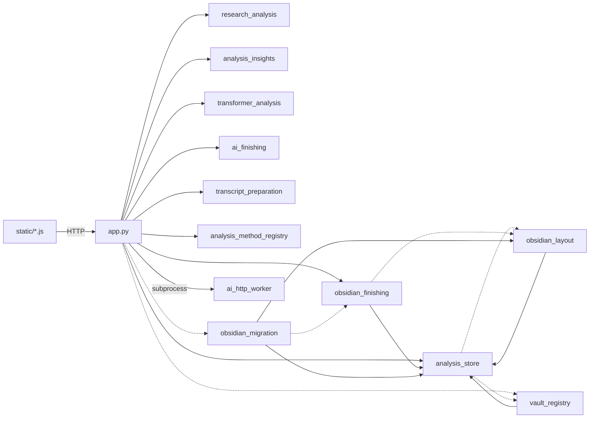

# システム全体構造・データフロー・設定の所在：システム全体構造・データフロー・設定の所在

親索引・状態・確認版：[[10-Architecture/10-System/system-map/00-Index]]。必要な本文だけを取得する。

# システム全体構造・データフロー・設定の所在

- **確認元：** 2026-09-14の調査内容は、ブランチ`agent/expand-analysis-ai-workflows`のコミット`1b8fe41`に収録し、プッシュ済み。
- **最新反映：** HEAD`2f13f98`（2026-09-26）。会話ゴミ箱・データバックアップ・生成ノートの共通書き込み方針・画面別テンプレートを現行コードに合わせて追記した。
- **調査条件：** 行数は初回調査時点の概数。2026-09-15に収録版の表記を更新した。優先修正による保存・UIの動作変更は[[40-Design/50-Governance/convergence-plan/02-section#優先修正の実装（2026-09-14）|convergence-plan#優先修正の実装（2026-09-14）]]を参照する。
- **関連ノート：** 問題点は [[40-Design/50-Governance/known-issues/00-Index|known-issues]]、整理方針は [[40-Design/50-Governance/convergence-plan/00-Index|convergence-plan]] に分けて記録する。

## アプリの目的（コードから推定）

会議やグループインタビューの録音を、ローカルPCで文字起こし・話者分離する。研究者が確認・修正した逐語録を正本としてSQLiteに保存する。そこから、根拠となる発話にたどれる分析結果を作って固定保存し、Obsidianで読んで考察する。

中心となる価値は、「逐語録 → 分析 → 根拠発話」のつながりを失わずにたどれることにある。AI（校正・話者特定・アウトライン・見解）は下書きを作る補助で、確定するのは常に人である。

## 層と担当モジュール（現状）

| 層 | 担当 | 主なファイル（行数） |
| --- | --- | --- |
| UI | 画面・状態管理・API呼び出し | `templates/index.html`（外枠・ダイアログ、約270）と `templates/views/`（画面ごとの断片：`create`・`library`・`result`・`analysis`・`speakers`）、`static/app.js`（約7,200）、`static/analysis-content.js`（約900）、`static/analysis-storage.js`、`static/interview-comparison.js`、`static/ai-effort.js`、`static/style.css`（約1,600） |
| API | Flaskのルート（84件、`tests/fixtures/route_map.json`）、要求の検証・セキュリティ | `web/*_routes.py`、`web/security.py`。`app.py`（約1,900行）は `create_app()` で登録し、依存を組み立てる（2026-09-25、[[70-Changes/10-Compatibility/app-py-phase5\|app-py-phase5]]） |
| Core／Service | ジョブ、文字起こしパイプライン、編集トランザクション、話者台帳、会話集計、議事録、出力、AI呼び出し | `handlers/`、`services/`、実行時状態は `runtime_state.py`。`app.py` には依存を渡す関数が残る |
| データ保護・復旧 | 会話の削除・復元・保持期限、データのバックアップ・hash検証・復元 | `services/library_trash.py`、`services/data_backup.py`、`web/library_deletion.py`、`scripts/backup_data.py` |
| 分析サービス | 日本語解析・統計・Excel、見解・KWIC、Transformer、手法登録、逐語録の準備 | `research_analysis.py`、`analysis_insights.py`、`transformer_analysis.py`、`analysis_method_registry.py`、`transcript_preparation.py` |
| AIサービス | 分割・校正・アウトライン、エフォート、HTTP通信（別プロセス）、拒否・途中終了の判定と一時障害の再試行 | `services/ai/transcript_finishing.py`、`services/ai/client.py`、`ai_finishing.py`、`ai_effort.py`、`ai_http_worker.py` |
| Data | 固定成果物と台帳、生成ノートの共通書き込み・履歴方針 | `analysis_store.py`、`vault_note_policy.py`（共通関数 `safe_path`・`write_atomic`・`markdown` は `analysis_store.py`） |
| External Integration（Obsidian） | ResearchVaultの構成・ナビ、仕上げ作業台、旧階層移行、4 Vault | `obsidian_layout.py`、`obsidian_finishing.py`、`obsidian_migration.py`、`vault_registry.py`、`vault_note_policy.py` |
| 互換 | `import app` などの旧importを受ける | `src/app.py` ほか5件。`gurumoji.*` へ付け替えるだけ。テストが使用している |

依存関係（実線は通常のimport、点線は関数内でのimport）：

次の組は、関数内でimportすることで循環依存を避けている。

- `analysis_store` ⇄ `obsidian_layout`／`vault_registry`
- `obsidian_finishing` ⇄ `obsidian_layout`

原因は、下位の共通関数（パス検証・原子的書き込み・Markdownエスケープ）が上位の `analysis_store` に置かれていることにある（[[40-Design/50-Governance/known-issues/00-Index|known-issues]] の ARCH-02）。
