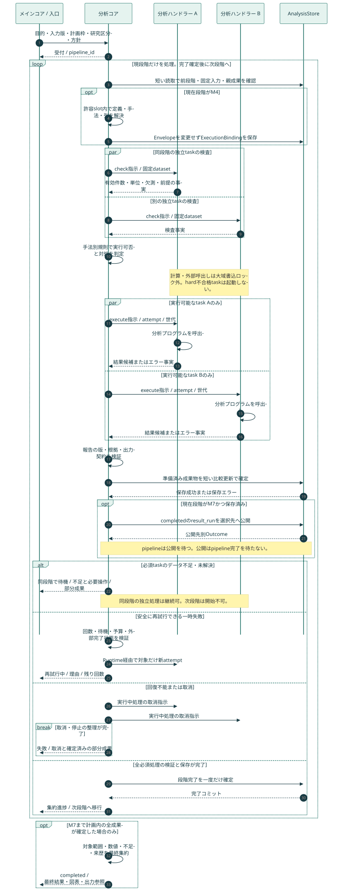

# 分析マイルストーン・可視化プログラム・UI統合設計：4. 実行管理プログラム

親索引・状態・確認版：[[40-Design/10-Analysis/analysis-milestone-visualization-design/00-Index]]。必要な本文だけを取得する。

## 4. 実行管理プログラム



[PNG画像](../../../analysis-design/analysis-sequence.png) / [編集可能なMermaid原本](../../../analysis-design/analysis-sequence.mmd)。並列分岐・失敗・取消・保存確定を含む。

### 4.1 責務分担（以下の新規名は実装案）

| 責務 | 既存の接続点 | 実装するプログラムと入出力 | 対応UI |
| --- | --- | --- | --- |
| 分析全体の統括 | メインコア・既存AnalysisCommands/Queries | AnalysisCoordinator：要求受付→実行可否判断→ハンドラー指示→結果集約→メインへ応答。純粋な判定規則とRuntimeを内包 | S02/S03 |
| 計画生成・検証 | handlers/analysis_commands.py | AnalysisPlanService：手入力/AI案＋入力snapshot→版付きPlan、steps、依存、資源要件 | S02 |
| 永続実行・ゲート | 既存要求台帳、static/analysis-execution.js | MilestoneCoordinator：Plan→attempt、ready queue、ゲート確定。UIから計算順を決定しない | S03 |
| 既存手法の実行 | research_analysis / transformer_analysis / segment_classification / analysis_insights | MethodRunner adapter：固定入力参照＋定義→ResultBundle | S01/S03 |
| 新しい意味分析 | method_experts、既存AI呼び出し | OutlineRunner、StanceRunner、InterviewEvaluationRunner、InteractionRunner：根拠付き構造結果 | S01/S05/S06 |
| 定義・生成変数 | 手動コード・分析条件 | DefinitionService / MeasurementRunner：定義→試行→採用版→値。式は許可演算の宣言形式のみ | S02 |
| データセット構築 | research_analysis._segment_dataset | DatasetBuilder：粒度、親表、列、集約、欠測→型付き固定表 | S02/S04/S05 |
| 統計・質的分析 | 既存SciPy統計、専門家定義 | StatisticsRunner / QualitativeRunner：適用条件付き結果。手法未対応は開始前に明示 | S01/S05 |
| 可視化 | static/app.js、analysis-content.js の既存図表 | VisualizationService：結果表＋ChartSpec→ブラウザー用図・代替表・画像 | S01/S04/S05 |
| 出力 | research_analysis.build_analysis_workbook | ExportService：固定dataset/ChartSpec→SAV/SPS/CSV/XLSX/画像/ZIP | S04 |
| 保存・検索・配信 | AnalysisStore / AnalysisQueries / web/analysis_routes.py | 既存storeを版付き拡張。artifact一覧・取得・再公開経路を再利用 | 全画面 |

1手法1画面にはしない。共通の結果カード・図表・根拠ドロワーに、手法別の設定と結果schemaを接続する。

### 4.2 ゲートと状態

Step状態：`planned → checking → ready → running → validating → persisting → committed`。再利用は検証を通して `reused`。別状態は `waiting_resource / awaiting_input / retry_wait / blocked / failed / cancelling / cancelled / interrupted / not_applicable`。データ不足・前提不成立・回復不能等はreason_codeで区別し、分析コアが状態と対処を決める。遷移の正本は第18.1節の状態遷移表とする。

Milestoneは所属する全stepが `committed / reused`、または確定計画で明示的に許容された `not_applicable` のいずれかで、全必須artifactが検証・登録済みのときだけ完了。`not_applicable` は適用性の判定記録であり、分析の成功ではない。判定理由・規則版・検証者を保存する。必須分析のデータ不足やエラーを適用外へ置換して段階を通過させない。判定不能の値を含んでも当該手法の網羅性・完了条件が満たされれば結果は確定できる。

必須不変条件：`start(M[k+1]) > commit(M[k])`。M[k+1]がM[k]に依存しない処理でも先行開始しない。段階内は同段階の親stepと前段階までの確定結果を参照できる。親の完了前には起動しない。

実行可否の骨格：

```text
current = 最初の未完了milestone
ready = current.steps のうち、親成果が確定し適用性検査が実行を許可した未開始step
ready を CPU / GPU / provider 別上限内で起動
全結果の検証と保存後、比較更新でcurrentを一度だけ完了にする
失敗・確認待ち・取消があれば後続milestoneを起動しない
```

CPUプロセス数、GPU同時実行数、provider別の同時要求数・レート制限を分離する。初期GPU枠は1を候補とし、実測で調整。外部APIは上限・バックオフ・取消を扱う。段階内並列は必須だが、依存または資源制約による待機は許す。高速化率を事前に保証しない。

### 4.3 保存、二重実行、回復

- 既存計画案の `analysis_pipeline_requests` / `analysis_step_attempts` を拡張候補とし、類似の第三台帳を作らない。計画版、milestone、step、attempt、親artifact、開始・終了、lease、取消要求、エラーを記録。
- fingerprintに本文版、定義版、手法版、実パラメーター、モデルの解決済み版、親artifact hash、scopeを含める。`latest` の文字列だけで同一性判定しない。
- ワーカーはattemptごとに固有の一時出力を書き、検証後に固定artifactへ昇格。既存AnalysisStoreの登録経路を使い、短いSQLiteトランザクションでmanifest参照と状態を確定する。
- ファイルとSQLiteは同一トランザクションではない。登録済みartifactだけを公開し、再起動時に孤立ファイル・欠損ファイル・中断attemptを照合する。`writing` を成功扱いしない。
- 二重POSTはrequest_idで再利用。再試行はattemptを増やし、成功済み兄弟stepを再実行しない。外部AI要求の不明な完了状態を自動再送せず、重複課金を避ける。
- 取消後に到着した応答はattemptの世代と取消状態を確認し、後続起動に使わない。完了済み成果物は保持する。
- 実行中の編集は現行snapshotを変えない。新版の実行は別Planとし、影響する結果と子孫をstaleにする。
- Vault公開の失敗は分析計算から分離。選択した出力にVault公開を含む場合、出力段階の完了だけを止め、再公開でAIを呼ばない。
