# 分析マイルストーン・可視化プログラム・UI統合設計：7. UI構造と操作

親索引・状態・確認版：[[40-Design/10-Analysis/analysis-milestone-visualization-design/00-Index]]。必要な本文だけを取得する。

## 7. UI構造と操作

[画像生成による4画面案](../../../analysis-design/ui-concept-v2.png) / [手動入力の画面図](../../../analysis-design/ui-plan.png) / [実行状況の画面図](../../../analysis-design/ui-run.png) / [スマートフォン幅の画面図](../../../analysis-design/ui-mobile.png)。画面図はオフライン試作のキャプチャであり、アプリ本体の実装結果ではない。

既存の上位ナビ「新規作成／処理済みデータ／話者管理」を維持。「分析・可視化」の作業単位を「結果を見る／比較する／分析を組む／データ・出力」に整理し、実行状況は常時チップから開く。

| ID | 画面/領域 | 主な部品 | 操作と到達結果 |
| --- | --- | --- | --- |
| S01 | 結果を見る | 対象選択、論点リスト、結果カード、図/表、条件バー | 論点や話者で絞る。クリックしたセルの根拠をS06へ。追加分析はS02へ選択を引継ぐ |
| S02 | 分析を組む | 自動/手動、定義エディター、列選択、手法選択、試行結果、計画プレビュー | 手入力→保存→少数試行→定義固定→手法/カラム確定→実行。条件不適合は項目単位で表示 |
| S03 | 実行状況 | M0〜M7、段階内task一覧、資源待ち、失敗理由、使用量 | 完了済み結果を見る、中止、失敗のみ再試行。次段階へ強制移動するボタンは設けない |
| S04 | データ・出力 | dataset粒度/列、変数辞書、形式選択、図プレビュー、寸法/背景、出力進捗 | 個別保存、ZIP、失敗形式のみ再試行。選択条件を出力版に固定 |
| S05 | 比較する | 2結果の選択、入力版・尺度・単位、比較マトリクス、根拠 | 互換性があれば差分算出。不適合は並べて閲覧のみ、理由を表示 |
| S06 | 根拠ドロワー | 引用、前後文脈、話者、時刻、原文版、推定/人手 | 音声/編集画面へ。閉じたら元セルとスクロール位置へ戻る |

### 7.1 手動の必須入力と検証

ラベル名だけでなく「測定方法」と「尺度」の自由入力/構造入力が必要。選択済み既存変数を使う場合はその採用版を参照できる。入力列、生成する列、分析対象列を別欄にする。複数ラベルは複数の真偽列または対応表へ展開し、観測数を水増ししない。

例：ラベル「導入への賛否」／測定「話者×論点ごとに対象提案への立場を分類」／尺度「名義：賛成・反対・中立・第三案」／対象列「立場・所属」／手法「クロス集計」。質問されて話した頻度を、興味の尺度へ黙って置換しない。

手動定義はLLM生成を必須にしない。定義に従う全件評定の実行元は人手/規則/LLM/JEVから対応可能なものを選ぶ。推定値を研究者確定値へ自動採用しない。名義の立場にPearson相関を選んだ場合は理由付きで拒否し、利用者が変更するまで待つ。

### 7.2 状態とレスポンシブ

`empty / draft / validating / awaiting_input / running / completed / failed / cancelled / interrupted / stale / unavailable` を文字とアイコンで示す。色だけで状態や賛否を識別させない。100%表示は検証・保存完了後。件数表示と進捗率を区別し、重み不明な処理の残り時間を断定しない。

1280px以上：論点240px＋結果可変＋根拠360px。960〜1279px：根拠は重ねるドロワー。959px以下：論点をセレクター、段階を縦並び、根拠を全画面にする。390pxでページ全体の横スクロールを避け、表の内部だけ横スクロール可能。入力ラベル、キーボード操作、Escapeで閉じる、フォーカス復帰、未保存離脱確認を必須とする。

UI画像からの構造化はS01〜S04の見た目を上表とJSONへ対応付けたもの。画像に省略されたS05/S06の詳細、失敗/欠測/モバイル状態はJSONとHTML試作で補完する。実装時は画像中の文字をOCRして仕様へ逆輸入しない。
