# 分析マイルストーン・可視化プログラム・UI統合設計：13. メインコアから独立した分析サブシステム

親索引・状態・確認版：[[40-Design/10-Analysis/analysis-milestone-visualization-design/00-Index]]。必要な本文だけを取得する。

## 13. メインコアから独立した分析サブシステム

### 13.1 今回の設計判断

利用者の「様々なLLMが共通形式で使える」を要件として採用する。**メインコア、分析ハンドラー、分析コア、分析実行管理、分析プログラム、役割別オーケストレーター、LLM接続アダプター**を責務で分ける。初期は同一アプリ内のモジュール分離とし、重い計算だけワーカーへ出す。独立サーバー・別DB・マイクロサービス化を必須にしない。

**分析コアを分析サブシステムの統括窓口とする。** メインコアとの要求・進捗・結果の応答、データ不足・エラー時の判断、分析ハンドラーへの指示、結果の集約、段階完了の決定を担う。内部をAnalysisCoordinator（統括）、純粋な判定規則、Runtime（実行機構）へ分ける。純粋規則はI/Oを持たず、統括は注入されたポートを通じて指示・保存する。従来の「Core＝純粋ルールだけ」という呼称は、この利用者要件に合わせて「分析コア内部の純粋規則」に限定する。



### 13.2 各層の責任と禁止する依存

| 層 | 持つ責任 | 持たない責任・参照しないもの |
| --- | --- | --- |
| メインコア / composition root | アプリ起動、設定解決、文字起こし・話者・入力の管理、共通資源の割当、依存の組立て | 分析手法の中身、M0〜M7の完了判断、分析用プロンプト |
| 入口アダプター（既存AnalysisCommands/Queries） | UI/HTTP/Obsidian/任意MCPの要求を正規化し、分析コアに渡す。要求ID・権限・送信条件の照合 | 分析の実行順・データ不足への最終判断 |
| 分析コアの統括（AnalysisCoordinator） | メインとの応答、適用性・回復方針の判断、ハンドラー指示、結果のまとめ、段階ゲートの確定 | 個別手法の計算、具象provider SDK・app.pyへの逆import |
| 分析コア内部の純粋規則 | 型・尺度・単位・データ充足性、計画の依存、エラー分類と対処規則、ゲート、再利用・古さ、結果検証 | SQL、ファイル、環境変数、HTTP、provider SDK |
| 分析コア内部のRuntime | コアの指示に基づく永続要求、ワーカー起動、資源枠、取消・再試行・回復の実行機構 | 対処方針の独自変更、二重台帳、次段階の先行実行 |
| 分析ハンドラー（実行側） | コアの版付き指示を受け、入力取得・事前検査・分析プログラム呼出し・報告を実施。複数ハンドラーを段階内で並列実行 | 次の分析選択、独自再試行・手法変更、ゲート解除、メインへの直接結果通知 |
| 各種分析プログラム / MethodRunner | 固定入力と定義による1手法の処理。ResultBundleを返す | 次手法の起動、他runの状態更新、Vaultの直接編集 |
| 各種オーケストレーター | 目的から計画・定義・分析契約・確認事項・図の仕様の候補を作る | ゲート解除、任意コードの実行、勝手なモデル変更、結果の直接確定 |
| LLM Gateway / provider adapter | 能力確認、共通要求の変換、認証、呼出し、使用量、タイムアウト・取消の正規化 | 研究上の意味検証、手法の自動置換、設定外providerへの送信 |
| 保存・Obsidian連携 | 既存AnalysisStoreの固定保存・再公開、既存Registry/Workbenchの所有権・競合処理 | 新しい正本の二重作成、同期からの暗黙の分析開始 |

指揮系統は「メインコア → 分析コア → 分析ハンドラー → 分析プログラム」。戻りは「分析プログラム → ハンドラー報告 → 分析コアで検証・集約 → メインコアへ応答」。UI等の入口アダプターも同じ分析コアへ要求を渡す。メインは構成を組み立てるが、ハンドラーへ直接の分析指示を出さない。LLMオーケストレーターの候補も分析コアで検証する。

従来文書の「ハンドラー」は入口も含む広い呼称だったため、入口アダプターと実行ハンドラーの役割を区別する。既存AnalysisCommands/Queriesの外部契約を維持し、実行側は既存runnerを包むTaskHandlerポートへ段階的に移す。コアから入口のAnalysisCommandsを再帰呼出しする構造や、別の分析台帳は作らない。

GPU等は文字起こしと分析で競合するため、資源管理は注入された共通ポートで連携する。メイン側の資源貸出が遅くても分析の意味・順番をメインコアへ戻さない。

### 13.3 ファイル構成案と既存機能の再利用

以下は全体拡張時の配置案。初回導入では純粋契約を `analysis_core.py`、永続schedulerを `analysis_pipeline.py` に置き、既存の `app.py`、`web/analysis_routes.py`、`handlers/analysis_commands.py`、`handlers/analysis_queries.py` へ接続した。未選択の役割別runnerはまだ分割していない。

```text
src/gurumoji/
  app.py                         # 起動・既存処理・依存の組立て
  web/analysis_routes.py         # 既存HTTP入口を維持
  handlers/
    analysis_commands.py         # 既存を拡張：計画/試行/実行/取消/出力/公開
    analysis_queries.py          # 既存を拡張：状態/結果/根拠/履歴
    analysis_tasks.py            # 実行側：コア指示→既存runner→観測事実・結果の報告
  analysis/
    coordinator.py               # 分析コアの統括：対処判断・指示・集約・メイン応答
    contracts/                   # Plan / ControlRequest / Directive / Report / Response
    core/                        # 純粋な計画・充足性・エラー対処・ゲート・結果検証
    runtime/                     # コア方針に従う永続要求・実行・資源枠・回復機構
    orchestrators/               # 役割別の候補生成・相談上限・prompt組立て
    methods/                     # 既存手法adapter、新規手法runner
    adapters/
      inputs.py                  # 原文・話者の固定snapshot取得
      llm_gateway.py             # 既存call_ai_json/JEV経路へのbridge
      knowledge.py               # ExpertCatalog＋対象ノートの取得
      obsidian.py                # 既存公開/差分取込みへのbridge
  research_analysis.py           # 既存の計算を当面そのまま再利用
  transformer_analysis.py
  segment_classification.py
  analysis_insights.py
  analysis_store.py              # 保存・公開の所有者を維持
  vault_registry.py
  obsidian_finishing.py
```

新設フォルダーを先に空で量産しない。1つのユースケースを縦に移し、差し替え・試験が必要な境界だけProtocol化する。既存のAnalysisCommands/Queriesに新しい同名ハンドラーを並立させない。既存の計算関数も移動そのものを目的にしない。

入力ポートはsnapshotを返し、保存ポートはAnalysisStoreを呼ぶ。手法は型付き値を返す。importは契約・純粋ルールへ向け、実行時に具象を注入する。すべての移行済み層からapp.pyへの逆importを禁止する。
