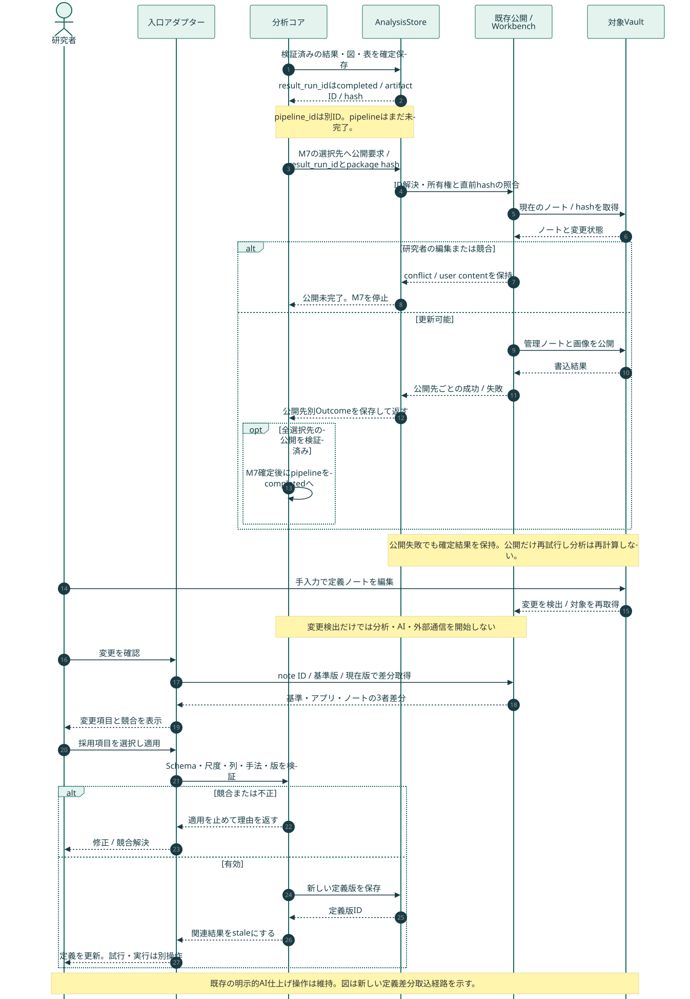

# 分析マイルストーン・可視化プログラム・UI統合設計：15. Obsidianとの連携設計

親索引・状態・確認版：[[40-Design/10-Analysis/analysis-milestone-visualization-design/00-Index]]。必要な本文だけを取得する。

## 15. Obsidianとの連携設計

### 15.1 接続方式と現行との差分

現行はPythonからVault内のMarkdownを直接読み書きし、Obsidian本体のAPIや専用プラグインを必須にしていない。この方式を維持する。Obsidianを閉じていても分析は実行できる。

現行の操作ノートにはAI仕上げの実行チェックがある。これは既存の明示実行経路として維持する。一方、今回追加する分析定義・考察の差分同期では、編集検出だけでAI・重い再分析・外部送信を開始しない。汎用の研究メモ・コード案取り込みは現時点で未実装である。

| Vault | 維持する役割 | 今回追加する読み方・表示 |
| --- | --- | --- |
| Software Vault | Git管理の仕様・手法・専門家定義。アプリは書かない | RoleDefinition/MethodCardを既存知識からコンパイルする根拠 |
| InputVault | 入力台帳・snapshot概要 | source ID、版、分析対象範囲。原文を重複配置しない |
| OrchestratorVault | 手法カード・run記録 | 採用計画、役割、モデル、M0〜M7、公開状態、未解決事項 |
| VisualizationVault | 図表の問い・表示条件・来歴 | 47成果物のノート、同じVault内の画像添付、表・根拠のartifact参照 |
| ResearchVault | 研究者の原文確認・メモ・解釈・AI仕上げ | 手入力定義と研究メモを編集できるノート、差分取り込みの入口 |

「4 Vault」は既存の4役割であり、ResearchVaultを含めると5つの保管庫を併用する。今回追加のOrchestratorVaultを別名で作らない。Persona関連の既存設計は役割定義の任意参照として扱い、この変更で新Vaultを増設しない。

### 15.2 アプリからObsidianへ

1. 分析結果・根拠・図・表をAnalysisStoreで先に確定する。
2. runに紐づく公開要求を既存の保存/公開経路へ渡す。
3. ResearchVaultはAnalysisStore/ObsidianLayout/ObsidianFinishing、生成3VaultはVaultRegistryの既存の所有権検証を通す。
4. 管理対象のID/hashを照合し、生成ノートと必要な画像を公開する。
5. ノートごとの公開成否と競合を記録し、索引を回復可能な順序で更新する。

公開ノートには `note_id, run_id, source_revision, definition_version, artifact_ids, source_hash, run_status, publication_status, review_status` と短い要約を置く。大量の発話ID、表、モデル入出力はartifactを参照する。

研究者の本文、タグ、別名、YAMLの未知キー、コメントは保持する。研究者が変更した生成ノートは競合表示し、黙って上書きしない。既存のhash確認と書込の間の競合リスクを、コア分離だけで解消したとは扱わない。ノート単位の書込制御、直前再照合、競合保存と再公開試験を追加要件とする。

### 15.3 Obsidian内で画像・グラフを見る

図の正本はAnalysisStoreのartifact。VisualizationVault内に表示用のPNGまたはSVGを、artifact ID/hash付きの管理添付として配置する。ノートは `![[同じVault内の添付画像]]` で埋め込む。これは表示用コピーであり、編集可能な第二正本にしない。新しい添付公開は現行の経路に追加する機能で、実装済みとはみなさない。

画像の下に対象数・観測単位・尺度・欠測・条件・根拠の説明を付ける。再分析で図が変わったら新しいartifactを発行し、旧runの図は保持する。インタラクティブな絞り込み・音声確認はアプリで開く。複雑なHTMLをObsidian内で自動実行する方式を前提にしない。

同じVault内のノートリンクはWikilinkを使う。Vault間はnote/run/artifact IDをresolverで解決し、必要に応じてObsidian URIまたはアプリの参照URLを出す。Vaultをまたぐ相対Wikilinkを必須の根拠にしない。Obsidianのノート関係グラフと、統計上の共起・応答ネットワークは別物として表示する。

### 15.4 Obsidianから分析へ戻す

研究者は専用の定義ノートで、ラベル、測定、尺度、対象列、手法を編集できる案とする。UIのS02と同じDefinitionDraftへ変換し、別の分析経路を作らない。人が読む説明は本文、ID/型/値域/列/手法は限定したYAML/JSON定義ブロックで編集する。

`note_id + base_revision + base_hash` を必須にし、「最後に公開した基準版」「現在のアプリ版」「編集されたノート」を比較する。通常の本文メモは注釈として扱い、LLMで勝手に定義へ変換しない。

取り込み順序：**編集検出 → ID解決 → 差分プレビュー → 利用者が採用する項目を選択 → schema/尺度/列の検証 → 競合がなければ新版を保存 → 関連結果をstaleにする**。その後の試行・分析開始は別の明示操作とする。

- ノートとアプリの両方が同じ項目を変更：競合として止め、選択した解決を新版に保存。
- 名称だけ変更：stable IDを維持。パスやタイトルから別の変数を作らない。
- ノート移動/欠損：既存経路のID解決・missing/conflictを尊重し、黙って再作成しない。
- 原文編集：既存Workbenchの反映経路を使い、研究メモ取り込みで原文を書き換えない。
- 尺度変更：定義版を増やし、旧値と混在集計しない。
- ノート削除：分析runや原文の削除へ連動しない。

研究者所有ノートを自由に全体再整形する同期は行わない。差分採用はユーザーの編集をアプリへ反映するための操作であり、単なるノート閲覧に承認操作を要求しない。

### 15.5 LLMがObsidianの知識を利用する

入口のID・目的から、索引→メタデータ/要約→必要な節・根拠範囲の順で取得する。既存のExpertCatalogを使い、読む候補を限定してContextPacketへ変換する。全文Vaultや全CSVを一括投入しない。

packetには各source ID/revision/hash、選択理由、抜粋、除外した範囲を含める。個人識別情報・ローカルパス・認証情報・不要な原文を含めない。研究本文が必要な分析では、その操作に許された範囲だけを明示して含める。キャッシュキーは目的・選択ID・版/hash・レンダリング版で固定する。

ObsidianはLLMが読める知識を作る編集窓口であり、LLMにファイルを直接実行させる環境ではない。チェックボックス、引用中の命令、Markdownリンクをsystem指示へ昇格させない。

### 15.6 M7と公開の完了条件

計算完了、出力完了、Vault公開、研究者確認、入力の古さを別軸にする。M7でObsidian公開を選択した場合、指定された公開先すべての検証・保存までM7を完了にしない。未選択の公開先は計画外と記録する。公開失敗時も分析結果は保持し、公開だけ再試行する。

現行AnalysisStore.publish_vaultsは生成Vault公開の例外を内部で扱う経路を持つため、戻り値だけで全Vault公開成功を判定できると仮定しない。まず既存の公開状態・例外通知を観測可能にする局所改修を行い、その記録を新ゲートへ接続する。新しい共通Publisherへの全面置換を前提にしない。
