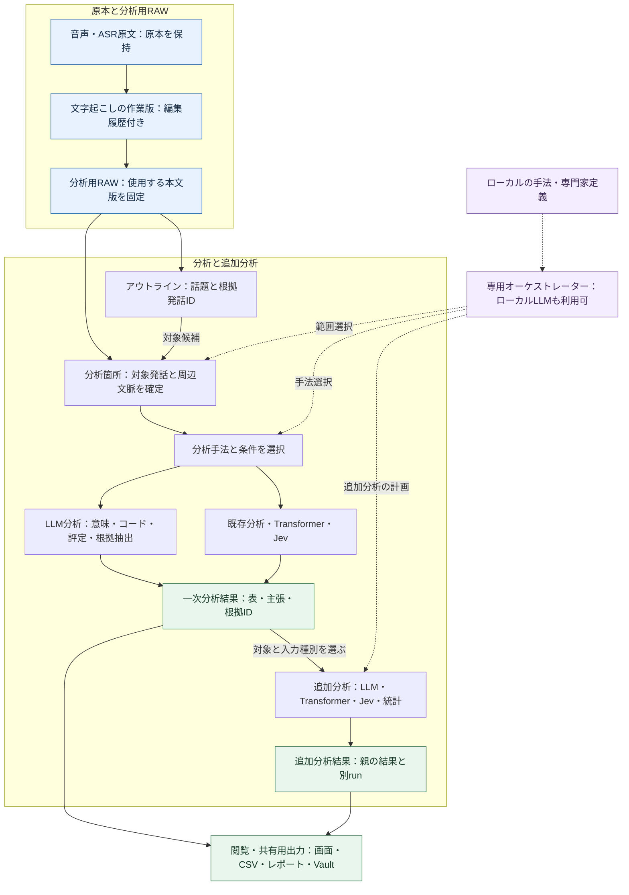

# コア・ハンドラー・ルーティング再編案：この資料の基準

親索引・状態・確認版：[[40-Design/10-Analysis/core-handler-routing-reorganization-plan/00-Index]]。必要な本文だけを取得する。

## この資料の基準

- 2026-09-20の作業ツリーを、現行コードの基準とした。未コミット変更を含む。
- `src/gurumoji/app.py` は確認時16,286行、HTTPルートデコレータは69件ある。件数は再確認し、手書きの固定値を合否判定に使わない。
- ER図の実線関係には、SQLiteの外部キーで強制される関係と、ID列だけで結ぶ論理関係が混在する。現状の多くは後者である。
- JSON列内の発話、話者対応、分析条件は概念上のエンティティだが、現行SQLiteでは独立テーブルではない。
- Vaultノートは大きな結果の正本ではない。正本はSQLite、`analysis_store`のJSON／CSV、メディアであり、Vaultは人が読む要約、台帳、操作面である。

## 分析の関連設計図：原文から追加分析まで

**読む順序は、①全体の流れ → ②結果を使う追加分析 → ③専用オーケストレーター → ④RAWと出力の保存境界 → ⑤LLM等で作ったカラムの統計分析 → ⑥疑似人格の相談で手法と型を作る → ⑦多様な結果を見るUI。** 実線はデータ・構造化した案の受け渡し、点線は計画・選択への介入を表す。以下は目標設計であり、現行実装の構成図とは区別する。

[7つの図をブラウザーで切り替えて見る](../../../analysis-flow-diagrams.html)。このHTMLは下記のMermaid図から生成した閲覧用出力であり、図の編集元は本書とする。[操作できるUI見本](../../../analysis-workspace-prototype.html)は架空データのみの設計モックで、実アプリへの接続・AI実行・保存は行わない。

### 図1：文字起こし・アウトライン・分析箇所・分析手法の関係

LLM分析はクラウド／ローカルのどちらでも同じ結果契約を使う。図の分岐は選択した分析だけを実行する意味であり、全エンジンの一斉実行ではない。

アウトラインは本文の代用品ではなく、分析箇所へ移動する索引・範囲候補として使う。アウトラインを使わず、発話・時間帯・話者・コードから直接範囲を指定する経路も残す。

| 要素 | 何を固定するか | 関連付けの規則 |
| --- | --- | --- |
| 文字起こしデータ | 会話ID、本文版、発話ID、話者、時刻、原本参照 | 発話IDは会話ID・本文版と組にする。異なる会話の同名IDを混同しない |
| アウトライン | 議題・要点ID、生成元snapshot、根拠発話ID、生成／手動の区別 | 手動の予定議題と、本文から得た実際の話題を区別。根拠のない旧形式から分析箇所を自動確定しない |
| 分析箇所（AnalysisScope） | 対象の発話ID集合、周辺文脈ID、除外ID・理由、分析単位、選択規則と版 | 時刻は表示・範囲指定の補助。実行時にID集合を確定し、周辺文脈を集計母数へ混ぜない |
| 分析手法 | method ID、手法版、適用条件、入力種別、パラメーター | 同じ範囲へ複数手法を適用可能。手法と実行エンジン・モデルは別に選ぶ |
| 分析結果 | run ID、行／主張ID、入力参照、根拠、出力schema、限界 | どの本文版・分析箇所から得た結果かを辿れる形で固定 |

例：アウトラインの「料金」の根拠が発話u12〜u19なら、対象をu12〜u19、文脈をu10〜u11・u20〜u21として保存する。分析者が対象をu14〜u17へ狭めた場合は、その選択を別scopeとして残す。重なるアウトラインを結合する際は発話IDを重複排除し、集計母数と選択理由を記録する。
