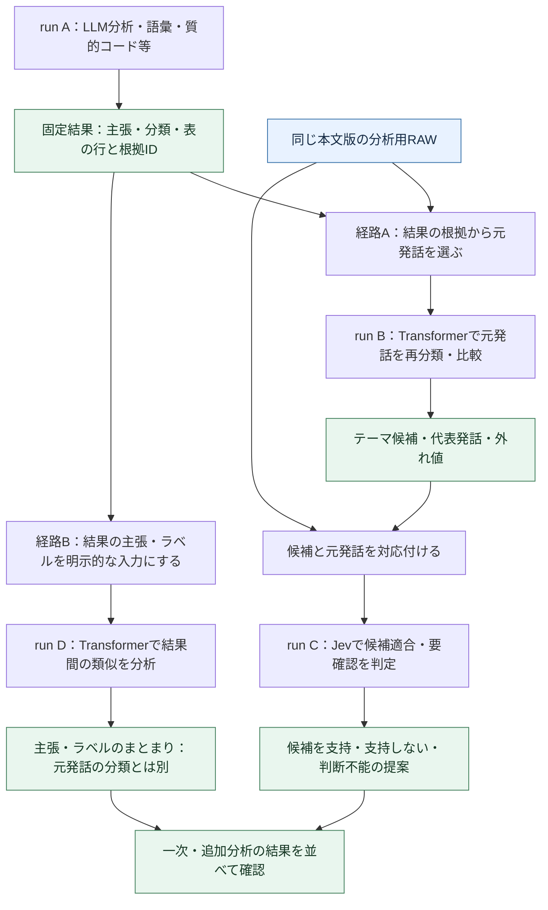

# コア・ハンドラー・ルーティング再編案：図2：分析結果からTransformer・Jevへつなぐ2経路

親索引・状態・確認版：[[40-Design/10-Analysis/core-handler-routing-reorganization-plan/00-Index]]。必要な本文だけを取得する。

### 図2：分析結果からTransformer・Jevへつなぐ2経路

- **経路A：元発話の再分析。** 一次結果は対象選択や候補定義の材料になる。Transformerへ渡す本文は保存時点のRAWから取得する。結果の要約文を元発話の代わりに使わない。
- **経路B：結果そのものの分析。** 入力単位は主張・分類・テーマ・結果行であり、発話ではない。`input_kind=analysis_result`として明示し、親artifactと行／主張IDを保持する。結果間の類似を、人間の発話の一致率・合意率として表示しない。
- LLMも両経路で分析を担当できる。元発話の意味・コード・評定を分析する場合と、既存の主張・分類を比較して根拠付きの整理案を作る場合を分け、入力種別を記録する。LLM出力の任意の文章から無定義に数値を抜かず、統計に使う値は図5のカラム契約に従って生成する。
- Jevによる追加判定は、候補と根拠を組にした専用の質問契約を追加する。現在のASR修正要否の質問を使い回さない。判断不能・根拠不足を保持し、推論結果を研究上の確定事項にしない。
- 追加分析は必要な経路だけを実行できる。A→B→Cを必須の直列処理にせず、A→C、A→B、複数の一次結果→Dも許可した計画で選べる。図のJev工程はクラウド利用が許可された場合だけ実行する。
- 既存Transformerは発話の時刻・話者を前提にする。経路Bではその関数へ架空の時刻・話者を補って渡さず、埋め込み等の純粋な計算を再利用する結果文用adapterを追加する。発話量・時間構造・話者統計は結果文に対して計算しない。

**現行と拡張の境界：** 現在は発話分類が保存済みTransformer結果を併記でき、Jevは原文の修正要否と発話分類を扱う。任意の結果を入力にする追加分析、親子runの依存管理、上記の候補適合判定は新規拡張である。

手法間の接続例（必須の一本道ではない）：

| 前の分析 | 次に渡すもの | 続く分析 |
| --- | --- | --- |
| 語彙頻度・共起 | 語・関連語・根拠発話ID | KWICで文脈確認→コード候補の検討 |
| 質的コード・KWIC | コードが付いた発話と元本文 | Transformerで類似・外れ値を探索 |
| Transformerテーマ | 候補ラベル・代表発話・根拠 | Jevで候補への適合／判断不能を提案 |
| Jev・手動の発話分類 | 出所別の分類値と発話ID | 属性別のクロス集計・結果間の不一致比較 |
| LLMのコード・評定 | 定義済みコードの値、尺度付き評定、根拠、未判定理由 | 型付きカラム→分析単位へ集約→統計エンジン |
| 複数の分析見解 | 主張テキスト・結果行ID・元の根拠 | 結果文用Transformerで主張を整理→根拠へ戻って確認 |

自動分類と手動確定値を同じ列に混ぜず、統計の母数・分析単位・手法の前提を次段でも検証する。
