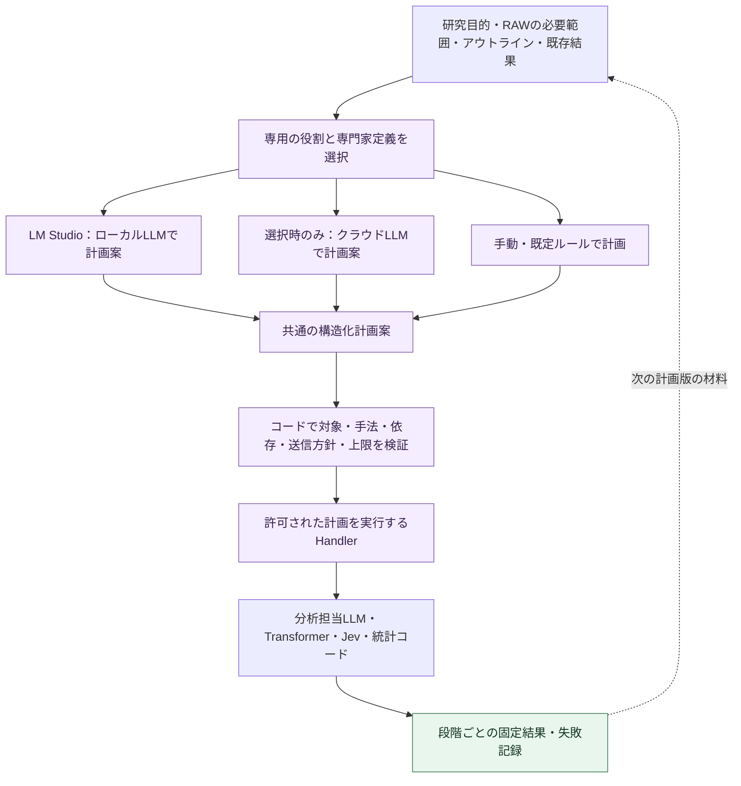

# コア・ハンドラー・ルーティング再編案：図3：専用オーケストレーターの介入とローカルLLM

親索引・状態・確認版：[[40-Design/10-Analysis/core-handler-routing-reorganization-plan/00-Index]]。必要な本文だけを取得する。

### 図3：専用オーケストレーターの介入とローカルLLM

この図の点線は次の計画作成へのフィードバックであり、保存済みrun間の循環依存ではない。

| 専用の役割 | 介入する場所 | 返す案 |
| --- | --- | --- |
| 分析箇所担当 | 文字起こし・アウトライン→scope | 対象ID、必要文脈、除外理由、選択の根拠 |
| 分析手法担当 | scope・研究目的→分析計画 | 手法ID、順序、適用条件、必要能力、出力の種類 |
| LLM分析専用オーケストレーター | 分析目的→手法別契約→LLM／Jevの実行→後続への引渡し | 図6の相談を統括し、質問・尺度・出力型・実行先・試行・再利用条件を固定する |
| 追加分析担当 | 一次結果→次の計画 | 入力にする結果／根拠、Transformer・Jev等の用途、停止理由 |

「専用」は役割別の入力・指示・出力契約を意味する。同じローカルLLMを順番に利用でき、役割数と同数のモデルや常駐エージェントを必須にしない。手法の専門家定義は既存`ExpertCatalog`から読む。現行コードは定義参照のみで、疑似人格の相談は図6で追加する機能である。LLMに渡してよい段階は手法のAI補助制約にも従い、相談を理由に禁止段階を許可へ変えない。

**計画担当LLMと分析担当LLMは別の呼び出しとして扱う。** 前者は対象・順序・手法を提案し、後者は指定されたRAWまたは分析結果から意味・コード・評定・根拠を生成する。同じmodelを共有できるが、プロンプト版・入力・usage・結果・取消状態を混ぜない。統計量とp値は統計コードで計算する。

計画案は`steps[]`に`step_id`、`task`、`method_id`、`input_refs`、`scope_ref`、`depends_on`、`parameters`、必要能力、選択理由を持つ。実行先は利用者の設定と能力検証で解決し、LLMにURL・資格情報・任意の実行コードを決めさせない。計画の品質確認と実行許可はコード・利用者の設定が担う。

ローカルLLMでもクラウドLLMでも同じschemaで検証する。不正な手法、存在しない根拠、循環、過大な入力、送信方針違反は実行前に拒否する。JSON修復は設定した少数回の範囲に限り、解決しなければ手動／既定計画へ戻れるようにする。ローカル失敗を理由にクラウドへ切り替えない。

利用者が指定した対象・許可手法・送信先・回数／時間／追加分析深度の範囲内では、事前に許可された段階を連続実行できる。追加案がその範囲を超える場合だけ新しい計画として提示する。各段階は実行理由を残し、「追加分析不要」「根拠不足」「上限到達」を停止条件にする。結果が返るたびに無制限に再計画しない。

ローカルだけの構成は**ローカルLLMの計画・分析・カラム生成＋既存の分析／統計コード＋ローカルTransformer**で成立する。Jev相当の判定をローカル生成モデルへ実装する場合は別engine・別の質問版・評価結果として記録し、Jevを実行したとは表示しない。Jevは必須依存にしない。
