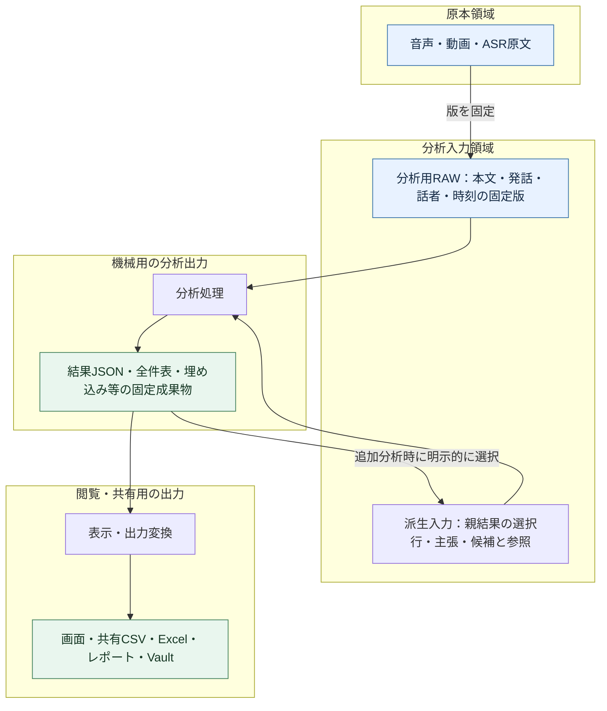

# コア・ハンドラー・ルーティング再編案：図4：分析用RAWと出力データの明確な分離

親索引・状態・確認版：[[40-Design/10-Analysis/core-handler-routing-reorganization-plan/00-Index]]。必要な本文だけを取得する。

### 図4：分析用RAWと出力データの明確な分離



図の結果→派生入力は、新しい子run用の入力作成を示す。元のRAWや親結果へ書き戻す処理ではない。

| 区分 | 内容 | 書込・再利用の境界 |
| --- | --- | --- |
| 原本RAW | 音声・ASR原文・取り込み元 | 保存済み原本を上書きせず、手動編集は別の本文版へ |
| 分析用RAW | 分析する本文版と必要な発話属性。AnalysisScopeはその参照集合 | 「RAW」は分析開始時の固定入力という意味。無加工の音声とは区別し、AIの要約・推測値を混入させない |
| 派生入力 | 再利用する固定分析結果と選択条件、必要なら固定した抜粋 | `input_kind=analysis_result`等で明示。元データと同じ扱いにしない |
| 分析出力 | 結果・主張・統計表・埋め込み・評価と根拠 | 後続分析が参照可能な機械用正本。入力artifactと区別して登録 |
| 閲覧・共有出力 | 表のプレビュー、丸めた値、表示用ラベル、Excel、Markdown等 | 自動で分析入力に戻さない。再取り込みは明示的な新規入力として来歴を付ける |

**物理配置も分ける。** 現行の`analysis_store/inputs/`と`runs/`を利用し、追加分析用入力を導入する段階で`derived_inputs/`を追加する。すべて同じ`AnalysisStore`の管理下に置き、独立した保存基盤は作らない。

現行の`archive_snapshot`は本文だけでなく条件・注釈・準備情報・話者集計も含む。既存JSON全体を無加工のRAWと呼び替えない。新しい入力契約では本文・属性のRAW部分、選択条件、手動注釈、派生値をschemaで分け、旧snapshotからは必要な項目だけを読む互換mapperを設ける。

```text
<data>/analysis_store/
  inputs/<snapshot_id>/input.json          # 既存：分析用RAWの固定snapshot
  derived_inputs/<packet_id>/input.json    # 提案：親結果を参照する追加分析入力
  runs/<run_id>/
    manifest.json                         # artifactの役割・版・依存先
    parameters.json                       # scope・手法・実行条件の参照
    result.json                           # 機械用の分析出力。既存結果の型付き値もここから取得
    tables/*.json                         # ADR-124の部分実装：新規runの全件表。型・欠測の区別を保持
    tables/*.csv                          # 既存：表計算ソフト向けの全件出力。無損失の読戻しは保証しない
    exports/                              # 提案：保存が必要な閲覧・共有用出力
```

- 新しいmanifestでは`analysis_raw`／`derived_input`／`analysis_result`／`presentation`の役割とschemaを記録する。JSONやCSVという拡張子だけで分類しない。snapshotやartifactはIDとhashで解決し、LLMにファイルパスを探索させない。
- 派生入力は親artifactと行IDの参照を基本にし、巨大な結果やRAWを複製しない。再現に必要な変換・抜粋を実体保存した場合は、それ自体のhashと変換版も持たせる。
- 表示の丸め、並び替え、切り詰めは出力側で行う。追加分析は全件の機械用成果物を読み、画面プレビューやMarkdown表を解析しない。
- 現行の`csv_bytes`は`null`と空文字を同じ空欄にし、`=`・`+`・`-`・`@`で始まる文字列に数式対策の`'`を付ける。`=A`と元から`'=A`の値は同じCSV値になり得る。CSVに全行があることと、型・欠測・元文字列を無損失で復元できることを区別する。
- FLOW-1以降の後続分析は、既存`result.json`の型付き値を優先する。2026-10-05の[[40-Design/50-Governance/decisions/00-Index|ADR-124]]で全件表保存だけを部分実装し、新規runの各CSVへ`tables/*.json`を対応させた。結果JSON内の配列の全件性を推測して重複排除せず、schema版・観測型・安定したrun内行ID・null/存在しないキー・元の欠測理由を保持する。親子run/依存manifestや意味上の列型の共通定義は未実装。既存CSVだけから安全に復元できない値は「復元不可」とし、空欄の意味や先頭の`'`を推測で戻さない。CSVの数式対策は維持する。
- 新しいCSVは型付き正本から作る閲覧・共有出力として役割を記録する。旧CSVの役割・hash・内容は後付け変更せず、旧reader／互換mapperが用途と制約を示す。`null`・空文字・0・数式風文字列・元からの`'`を区別した型付き正本の往復を検証する。
- 現行の`output/`やVault、既存runは移動しない。新しい`exports/`は追加分析の共有用成果物が必要な場合にだけ作る。既存CSVをダウンロードする場合はコピーを作らず、全件の表計算用出力とその読戻し制約を表示する。
- 原文の編集権限、RAW読取、派生結果の作成、共有出力の生成を操作として区別する。出力削除・再生成でRAWや親runを削除しない。共有出力はRAWと異なる公開範囲を持てるが、除外・匿名化は明示した出力変換で行う。
- 追加分析が本文以外の結果を扱う場合、その結果行を既存の`library_items`の発話として保存しない。実装時は[[30-Data/20-Analysis/analysis-storage-v1/00-Index|analysis-storage-v1]]を基に版付き拡張を定め、旧manifestと新manifestを読み分ける。旧成果物のhashや意味を後付けで変更しない。
