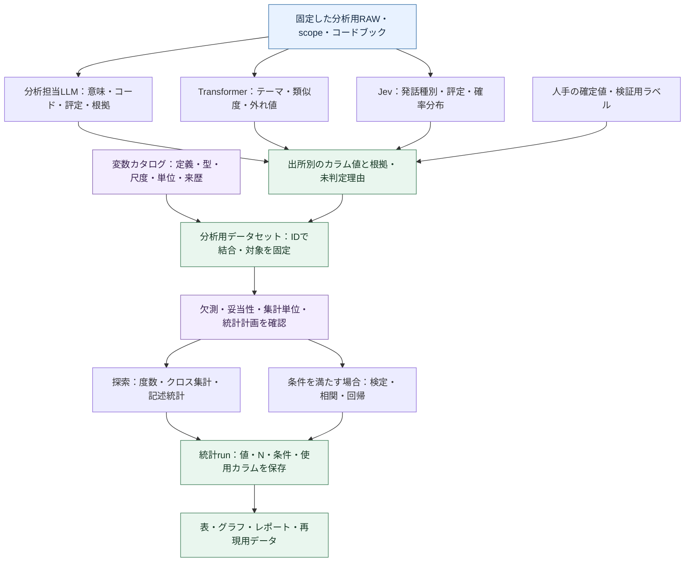

# コア・ハンドラー・ルーティング再編案：図5：LLM・Transformer・Jevのカラム生成から統計分析へ

親索引・状態・確認版：[[40-Design/10-Analysis/core-handler-routing-reorganization-plan/00-Index]]。必要な本文だけを取得する。

### 図5：LLM・Transformer・Jevのカラム生成から統計分析へ

**現状の結論：カラム化と一部の集計・検定は実装済みだが、任意の生成カラムを型付きデータセットにまとめて統計へ渡す共通経路は未実装。** LLMの分析と変数生成を明示的な工程として追加し、既存の[[40-Design/10-Analysis/quantification-statistics-plan/00-Index|quantification-statistics-plan]]へ接続する。

この図は目標設計。Jevは選択時だけ実行し、ローカルLLM・Transformer・手動値だけでもデータセットを作れる。数値計算はコードが行い、統計の再実行や出力のたびにLLMを呼ばない。

#### 現行コードでできること・不足していること

| 機能 | 現状 | 確認した実装 |
| --- | --- | --- |
| 一般のLLMによる分析見解 | 実装済み。根拠発話に基づく主張を生成・検証・保存する。一般のLLMによる任意の変数・評定の生成とは別 | `analysis_insights.create_ai_insights`、`validate_findings`、`app.call_ai_json` |
| Jevの判定をカラム化 | 実装済み。発話種別、テーマ候補、重要度・要確認度・機密らしさ、confidence等 | `segment_classification.classify_with_jev`、`classification_rows` |
| Transformer結果をカラム化 | 実装済み。テーマ、類似度、margin、外れ値などを発話IDに対応付ける | `transformer_analysis`、`segment_classification.transformer_proposals`／`classification_rows` |
| 分類結果の組合せ集計 | 実装済み。Transformer話題×Jev発話種別、手動コード×Jev発話種別、手動／ルールとの分類比較等の件数 | `segment_classification.crosstab_rows`。この関数は件数を数え、p値は計算しない |
| Transformer関連の検定 | 一部実装済み。相づち関連の分布に限定したカイ二乗・CramérのV・期待度数の注記 | `transformer_analysis._backchannel_test`。任意のTransformer列を選ぶ汎用検定ではない |
| 一般の統計処理 | 既存の固定数値変数、手動コード・質問候補・指定語について実装済み。生成列を任意選択する入口はない | `research_analysis._segment_dataset`、`NUMERIC_VARIABLES`、`_statistics_analysis` |
| 生成カラム→任意の検定・相関・回帰 | 未実装。変数カタログ、型付き結合データ、集約・検証状態、汎用列選択の接続が必要 | [[40-Design/10-Analysis/quantification-statistics-plan/00-Index\|quantification-statistics-plan]]の提案範囲。CSVへ出せることとアプリ内で統計へ接続済みであることを区別 |

現在の`segment_classification`の**`llm_*`列はJevが生成した値**である。OpenAI／Google／LM Studioで作った同等の変数が既に入るという意味ではない。既存CSV名は互換維持し、新しい変数カタログで`engine=typesafe`と明示する。一般のLLM列を追加するときに、既存のJev値を上書きしない。

2026-09-20の確認では、分類の値・カラム・クロス集計に関する既存4テストと、Transformer相づちの検定・効果量に関する1テストが成功した。Jevはスタブであり、実モデルの分析精度や未実装の汎用統計接続を検証したものではない。

#### LLMにも分析とデータ作成を担当させる

| 分析担当LLMの仕事 | 出力 | 統計へ渡す条件 |
| --- | --- | --- |
| 意味・論点・立場・理由の分析 | 主張ID、説明、根拠発話ID、引用、限界 | 文章のまま保存する経路を持つ。統計変数として使う場合は定義されたコード・尺度へ対応付ける |
| 定義済みコードの判定 | 発話×コードの有無・未判定、根拠、model・定義版 | 列定義に合う値だけ受け付ける。新しいコード案は検討用に保存し、採用・定義されるまで確定変数にしない |
| 定義済み尺度の評定 | 例：理由の具体性1〜5と根拠・未判定理由 | 各段階の意味・例・尺度水準を先に定義。単に数値であることを理由に連続量として扱わない |
| 結果間の比較・追加分析 | 主張／結果行ごとの支持・相違・根拠不足の提案 | 発話単位の列と分け、主張／結果行を単位にしたデータセットを使う |

分析用モデルは計画担当とは別に選択・固定できる。同じローカルLLMを兼用してもよい。既存の`create_ai_insights`の根拠ID検証、分割、上限付き再試行を再利用し、分析タスクに応じたschemaを追加する。自由形式の文章を後から推測でカラムへ変換する方式を標準にしない。

#### カラムとデータセットの最小契約

| 管理対象 | 必要な情報 |
| --- | --- |
| 行キー | `conversation_id`、本文版、`segment_id`。主張・結果行の場合は`run_id`＋`row_id`と`unit_kind`を使い、発話行と混在させない |
| 変数カタログ | 安定したvariable ID、表示名、意味、型、許容値、尺度、単位、集約規則、欠測規則、定義版 |
| 各値の来歴 | 出所（manual／rule／generative_llm／transformer／jev）、親run・artifact、model、prompt／schema版、入力hash、根拠、検証状態 |
| 未判定 | `null`と理由。未実行、失敗、対象外、根拠不足を0や「なし」へ置換しない |
| 確定データセット | dataset ID・版、採用した列と生成run、行キー、対象・除外・欠測、集約の単位・分母、内容hash |
| 統計run | 使用dataset ID・hash、変数ID、解析計画、使用行、N、計算方法・版、結果と前提注記 |

例（架空のデータ。`jev_*`は新しいカタログでの表示上の出所名）：

| 発話キー | `llm_stance` | `llm_reason_specificity` | `transformer_topic_id` | `jev_dialogue_act` | `jev_review_score` |
| --- | --- | --- | --- | --- | --- |
| 会話A・版3・u12 | 賛成 | 4 | topic_02 | answer | 20 |
| 会話A・版3・u13 | 留保 | 2 | topic_02 | reservation | 65 |
| 会話A・版3・u14 | null（根拠不足） | null | topic_01 | question | 40 |

この表は分析で生成した派生データであり、RAWの本文列へ書き戻さない。同じ発話からLLM・Transformer・Jevが作った列は横に結合できるが、3つの独立した観測として縦に積んで標本数を増やさない。本文版不一致、重複キー、意図しない多対多結合は拒否する。モデル由来のconfidence、類似度、選別スコアは異なる意味の変数として保持する。

#### 統計分析への接続と実行順序

1. 利用者が定義した分析・変数生成を明示実行し、結果を固定する。既存結果を再利用する場合はそのrunを選ぶ。統計ボタンから暗黙にAIで欠損列を埋めない。
2. 既存の分類JSONの型付き値をadapterで変数カタログへ登録し、一般のLLMで作る列も同じ入口から追加する。CSVしかない場合は図4の読戻し制約を検証し、値を推測で復元しない。SQLテーブルに列を動的追加する方式ではなく、版付きの機械用表とカタログを既存成果物基盤に保存する。
3. [[40-Design/10-Analysis/quantification-statistics-plan/00-Index|quantification-statistics-plan]]の`variable_catalog`、`stat_utterances`、`stat_speakers`、`stat_participants`、`stat_interviews`を共通設計として利用する。統計の変数台帳やエンジンをもう1つ作らない。
4. 手動の検証サンプルとの一致・群ごとの誤り・欠測を確認する。未検証のAI列は確認的な検定へ自動投入せず、探索用の度数・分布と検証状態を先に表示する。
5. 解析計画に沿って発話／話者／会話等の単位を決める。同一話者の多数の発話を無条件に独立標本として扱わず、既存統計計画の集約・反復データの扱いへ接続する。クラスタリングで作ったラベルと同じ特徴量の差を検定して、独立した仮説の裏付けとはしない。
6. データ型・研究デザイン・前提から、コードが実装済みの統計手法を実行する。未実装の手法は理由付きで利用不可とし、LLMに統計量・p値を生成させない。多重比較、効果量、不確実性等の詳細は統計計画を正本とする。
7. 同じ固定datasetから統計を再実行・出力できるようにする。生成model・定義・入力を変えた場合は新しい列版・dataset版を作り、過去の統計結果は保持する。

着手順は、**既存Jev／Transformer列の取込 → カタログ・結合・探索集計 → 一般LLMの分析／カラム生成 → 検証済み列を使う推測統計**。LLMの根拠付き見解は独立した分析として先に利用でき、統計機能の完成待ちにはしない。回帰や高度な検定をこの設計図の追加だけで実装済みと扱わない。
