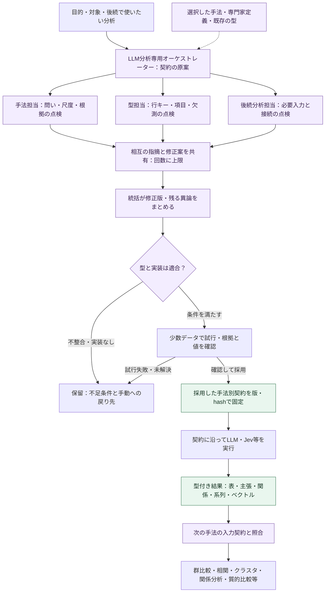

# コア・ハンドラー・ルーティング再編案：図6：LLM分析専用オーケストレーターと、相談で作る手法別の型

親索引・状態・確認版：[[40-Design/10-Analysis/core-handler-routing-reorganization-plan/00-Index]]。必要な本文だけを取得する。

### 図6：LLM分析専用オーケストレーターと、相談で作る手法別の型

**追加する設計。図6の全体は未実装。** O01の計画候補のみ、ローカルTransformerまたは明示選択したLLMで生成して既存の基礎分析計画に添付できる。以下の役割間相談・型の試行・後続分析への接続は未実装。`method_experts.py`の専門家定義参照と、以下の役割別LLM呼び出しを区別する。疑似人格は実在の専門家ではなく、確認の観点と出力契約を持つアプリ内の役割である。



図の試行・本実行は利用者が指定した送信方針と予算の範囲に限る。試行失敗や未解決の必須項目があれば保留し、契約を固定しない。相談のやり直しは新しい案の版として記録し、保存済み分析runの依存グラフには循環を作らない。

#### 相談する役割と、LLM・Jevの使い分け

| 役割 | 確認すること | 返す構造化データ |
| --- | --- | --- |
| LLM分析専用オーケストレーター（統括・提案） | 目的から分析手順を組み、対象、実行先、分割、予算、停止を管理 | 手法別契約案、担当への依頼、採用差分、残る課題、実行計画 |
| 手法担当の疑似人格 | 研究質問、概念・選択肢・尺度、根拠、許可されたAI補助段階 | 適用条件、禁止解釈、修正案、根拠となる定義ID |
| 型担当の疑似人格 | データの単位、キー、型、必須値、欠測、版の互換性 | 入出力schema案、例データ、検証条件、既存型との差分 |
| 後続分析担当の疑似人格 | 次の分析に必要な変数・関係・順序・分母が揃うか | 入力要件、変換・集約案、接続可否、情報損失、代替の手法 |

各役割は同じモデルでも、別のcontext packet・指示・応答・使用量を持つ。相談用入力は目的、型、定義、必要最小限の匿名化した例を中心にする。元発話を読む分析担当への入力は別に選ぶ。全員に原文全文や過去の全議事録を配らない。

LLMは契約案の作成・相談と、確定した契約に沿う意味・根拠抽出を担当する。**Jevは自由な議論役やschema生成役にせず、定義済み選択肢の判定と分布・スコアを担当する。** Jevの質問、選択肢ID、スコア写像、未判定規則は契約の中で固定する。Jevの数値にLLMが後付けした説明を、Jev自身が出した根拠とは表示しない。

共通契約から各engineへの要求は、対応するadapterが作る。生成LLMには対応範囲内の出力schema、JevにはChoice形式を渡し、応答を共通の結果型へ検証付きで写像する。両者に同じJSON schemaをそのまま送る設計にはしない。Jevやローカルモデルが表現できない型は、そのengineでは利用不可とし、勝手に別の実行先へ変えない。

初期の相談は統括＋必要な担当だけで行う。原案→担当の指摘→相互の指摘を踏まえた再確認→統括の修正版を既定とし、修正・再確認は最大2ラウンドの実装上の上限から始める。呼出回数・時間・トークン上限も先に固定し、上限・取消・意見不一致で停止できる。既に採用された同じ契約を使う場合は再相談を省く。

指摘は`issue_id`、対象フィールド、理由、定義／根拠ID、修正案、`blocking`、解決状態を持つ。相互に指摘を参照して回答し、採用しなかった理由も残す。多数決や全員の賛成を、統計的妥当性・独立した査読・実装の存在の証明にしない。重大な異論が残る場合は候補を並べ、既存契約か手動設定へ戻れるようにする。

#### 手法別契約で先に決めること

ここでの「型」はJSONの形だけでなく、**データの意味・単位・根拠・欠測と、次の手法が受け取れる条件**を含む。既存の[[90-Templates/10-Analysis/method-registration|method-registration]]と`analysis_method_registry`の契約を拡張する。新しい独立レジストリや、全手法を包み直すDTOは作らない。

| 契約の部分 | 固定する内容 |
| --- | --- |
| 識別と目的 | `contract_id`・版・hash、既存`method_id`との対応、目的、手法定義・専門家定義の版 |
| 入力 | 許容artifact kind・schema版、単位、必須列、行キー、根拠解決、対象・文脈・除外。実行時にscope・input hashを別のrun bindingで固定 |
| 分析手順 | LLMの指示・出力schema、Jevの質問・選択肢と写像、Transformerの設定、使用可能なengine、分割・再試行・上限 |
| 結果 | 値の意味、型・尺度・許容値、観測単位、主キー・参照キー、未判定理由、根拠、出所、対象と処理済み件数 |
| 次の分析への接続 | 受け側method ID・入力schema、必要な変換・集約・結合、単位・分母、失われる情報、実装能力の要求 |
| 検証 | 構造・値・ID・完全性・手法前提の検証、試行サンプル、期待される失敗、科学的妥当性の確認状態 |

例：発話の立場と理由を取り出す手法の契約案（以下のID・構造は設計例で、実行可能な新APIではない）。

```yaml
contract_id: utterance_stance_reason
contract_version: 1
status: draft
input:
  artifact_kind: analysis_raw
  unit: utterance
  key: [conversation_id, source_revision, segment_id]
output:
  artifact_kind: analysis_result
  shape: observation_table
  key: [conversation_id, source_revision, segment_id]
  fields:
    stance:
      type: string
      scale: nominal
      allowed: [support, oppose, conditional, unclear]
      nullable: true
    reason_specificity:
      type: integer
      scale: ordinal
      range: [1, 5]
      nullable: true
      rubric_ref: reason_specificity_v1
  evidence_required: true
  missing_reason_required_when_null: true
  provenance_required: true
downstream:
  - method_id: descriptive_statistics
    input_shape: observation_table
    column_mapping: [stance, reason_specificity]
    adapter_required: true
```

この案は尺度の定義`reason_specificity_v1`を実際に解決し、入力・出力schema版と全必須項目を埋めるまで採用できない。`unclear`は「有効な材料を読んでも立場が定まらない」という分類値、`null`は未実行・失敗・根拠不足等の欠測として定義を分ける。既存の`descriptive_statistics`がこの任意列をそのまま受け取れるとは限らず、図5のadapterと能力確認が必要である。

#### クロス集計以外へつなぐ結果の形

以下は接続の設計例。既存手法そのものがあっても、生成結果を受け取るadapterまで実装済みとは扱わない。

| 結果の型 | 保存する内容 | 後続分析の候補 | 接続時の確認 |
| --- | --- | --- | --- |
| 観測表 `observation_table` | 発話／話者等のキー、カテゴリ・評定・数値、根拠 | 記述統計、群間比較、相関、条件を満たす回帰 | 尺度・欠測・分析単位・集約と図5の妥当性ゲート |
| 根拠付き主張 `claim_set` | 主張ID、本文、支持・反証の根拠、限界 | 質的比較、反例の整理、結果文の埋め込み・クラスタ | 主張の集合を発話・人数と数え替えない。人の確定コードと区別 |
| 関係表 `relation_graph` | node ID、source／target、関係種別、方向、重み、根拠 | 共起・関係ネットワークの集計、関係の比較 | 関係の意味・重み・重複・自己辺を定義。支持と語の共起を混合しない |
| 順序・時間付きデータ `event_sequence` | 会話ID、順序、時刻、イベント、話者・対象ID | 話者遷移、時間窓別の変化、系列比較 | 時刻・順序・欠区間を維持し、別会話を1系列につながない |
| ベクトル・行列 `embedding_matrix` | 行ID、数値配列、モデル・revision・次元、入力種別 | 類似検索、クラスタリング、次元削減 | 数値は対応するencoder／計算コードが生成。LLMにベクトルを作文させず、異なる空間を混ぜない |

手法によって複数artifactを返してよい。たとえばLLMが主張集合と関係表を作り、Transformerが主張本文を埋め込み、Jevが定義済みの関係候補を判定し、後続が関係ネットワークを集計する。クロス集計を必須の中間成果物にしない。型担当は既存の形を組み合わせることを優先し、必要なものから段階的に増やす。

後続の手法は、kind／schema版だけでなく、単位・意味・キー・必要能力を照合する。変換が必要なら登録済みadapterをDAGの1段階として実行し、親artifact、変換版、入力・出力hash、欠測・件数変化を保存する。自動の文字列→数値変換や、意味の違う同名列の結合はしない。未実装の回帰・系列・グラフ手法は`planned`／`unavailable`とし、型を作っただけで実行可能にはしない。

#### 型の採用・保存・再利用と、増やしすぎない境界

1. **原案を作る：** 既存の型・手法登録票を探し、不足分だけ相談で補う。既存契約と入力要件が一致する場合は、その契約を選ぶ。
2. **コードで検証する：** 宣言的schemaの許可範囲、IDと参照の解決、尺度・根拠・結合、runner／adapterの能力、送信先・予算を検証する。生成したPython・SQL・シェルを実行する仕組みにはしない。
3. **試行する：** 許可された少数データで構造、根拠照合、未判定・部分失敗、後続へ接続できるかを確認する。schemaの検証成功と、科学的妥当性の確認状態は別に保存する。
4. **採用版を固定する：** `draft → schema_valid → pilot_valid → adopted`として契約の状態を管理する。利用者の事前設定内で既存テンプレートのパラメーターを埋める場合は自動採用できる。新しい概念・尺度・コードブック・単位の採用は候補・試行結果を示して研究者が決める。`adopted`は確認的検定への適格性を意味しない。
5. **その版で分析する：** 実行結果から契約・型・知識・モデル・入力の版を辿れるようにする。結果を見て値域・尺度・検定を都合よく変更せず、変更理由を付けた別版・別runにする。
6. **次の分析と再利用する：** 科学的妥当性と受け側の入力条件を別途検証する。再利用の一致条件は契約hash、選択した知識のhash、能力の版。データが変われば適用条件を再確認する。型の必須項目・意味・単位・尺度変更は新しい契約版とし、旧結果を黙って変換しない。

契約案・相談の指摘／応答・試行記録・採用した契約・schemaは既存`AnalysisStore`の版付きartifact／manifestで関連付ける。相談は分析runと分けて識別し、状態・使用量・取消は「段階実行の状態と再開」のSQLite記録を利用する。正本をMarkdownの議事録だけにせず、OrchestratorVaultには既存の生成経路で要約とstable IDを公開する。入力・結果・schemaが未対応の旧readerではその新しい実行種別を利用不可とし、既存runは従来どおり読める互換adapterを維持する。

再利用する役割・手法の定義は既存Software Vaultの登録経路で版管理する。生成案を直接`01-Expert.md`へ上書きしない。PersonaVault（ADR-114）は現状アプリの自動読み書き対象ではない。そこにある人格を使いたい場合は、利用者が選んだ定義だけを登録用候補として取り込み、ID・版・hashを検証する後続機能とする。今回の設計でPersonaVaultの走査・移行・長期記憶の自動更新は追加しない。

表示は図7の分析ワークスペースへ統合し、既存の分析方針／手法別の部品を利用する。「分析を組む」で目的、担当、結果の形式、次に使える分析、相談の異論、試行結果を示す。JSON schemaは詳細表示に留める。既存契約の選択→必要時だけ相談→試行→本実行を辿れ、停止後も既存契約・手動設定へ戻れるようにする。
