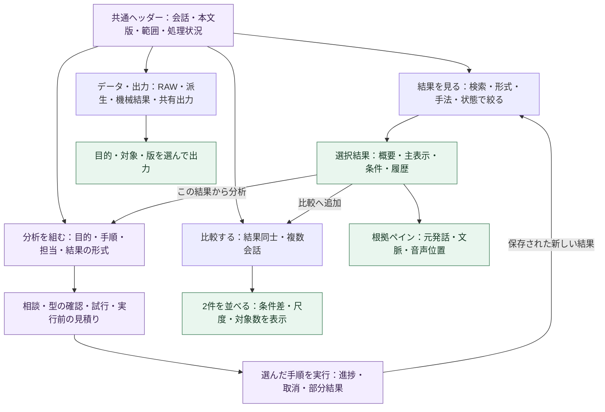

# コア・ハンドラー・ルーティング再編案：図7：多様な分析を探す・読む・比較するUI

親索引・状態・確認版：[[40-Design/10-Analysis/core-handler-routing-reorganization-plan/00-Index]]。必要な本文だけを取得する。

### 図7：多様な分析を探す・読む・比較するUI

**設計案・未実装。** 2026-09-20に`templates/index.html`、`static/app.js`、`analysis-storage.js`、`interview-comparison.js`（いずれも`src/gurumoji`配下）を読み、既存の[[20-Modules/40-Interface/ui-screens/00-Index|ui-screens]]と照合した。以下の課題評価はコードの確認に基づき、現行アプリの実データでの操作試験とは区別する。

#### 現行UIの問題と、再利用するもの

| 現状・根拠 | 多様な分析で困ること | 設計変更 |
| --- | --- | --- |
| 主な切替が「自動分析／設定・手動分析／手法別」 | 作業の目的と実装上の分類が混ざり、結果を探す入口が分散する | 「結果を見る／比較する／分析を組む／データ・出力」の4つに整理 |
| 手法別は`methodResultPanels`で全体の描画から対象パネルを抽出 | 1手法を読む入口はあるが、実行版・結果種別を横断して探しにくい。別の結果との関係も分かりにくい | 手法一覧を検索・絞込付きの結果一覧へ拡張し、選んだ実行と成果物を詳細表示 |
| `buildMethodDetail`が説明・専門家情報・複数の結果パネルを縦に並べる | 結果の主表示より説明が先に積み上がる | 結果を中央に置き、条件・担当・限界は見出し付きの詳細へ。重大な問題だけ常時表示 |
| 複数インタビュー比較は1件分析の下部の折りたたみ | 複数会話の比較と、LLM／Jev／Transformerの結果比較を見つけにくい | 「比較する」を主入口にし、結果比較と複数会話比較を区別して選ぶ |
| 保存履歴は別パネル、CSV名など実装上の名称が結果に出る | どの本文版・条件・モデルの結果か、再利用できるかを追いにくい | 結果に実行履歴・版・出所・親結果を結び、列名の日本語表示と意味を付ける |
| `renderAnalysisWorkspace`がPC／モバイル用の内容を両方描画 | 手法が増えるほど表示コストと状態管理が増える | 同じ結果モデルとレスポンシブな表示部品を使い、選択中の結果だけ描画 |

既存の手法別状態API、表・グラフ、根拠リンク、履歴・成果物取得、未保存変更確認は再利用する。手法別UIをもう1系統残して新UIを重ねる方針にはしない。移行中だけ旧表示への戻り口を残し、同等の導線を確認した段階で旧切替を外す。

この図は画面遷移であり、分析runの依存グラフではない。画面を開く、検索する、比較へ並べる操作ではAIを実行しない。新しい分析は実行内容を明示した操作で開始する。
