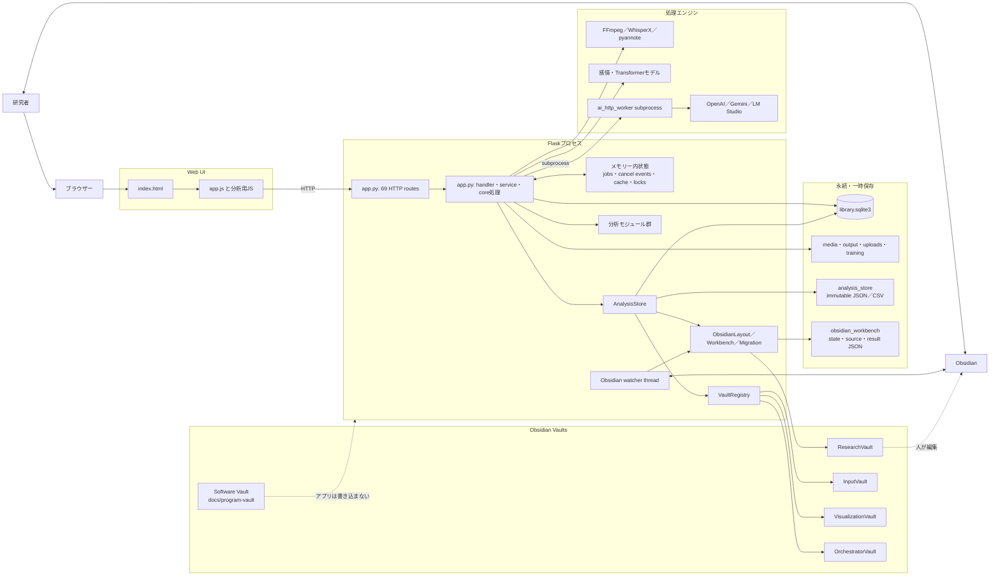

# コア・ハンドラー・ルーティング再編案：現行システム構成図

親索引・状態・確認版：[[40-Design/10-Analysis/core-handler-routing-reorganization-plan/00-Index]]。必要な本文だけを取得する。

## 現行システム構成図

### 現行構成で責務が交差している場所

| 交差 | 現状 | 結果 |
| --- | --- | --- |
| Routingと業務処理 | ルート定義と保存・分析・スレッド起動が同じ`app.py` | HTTPなしのユースケーステストが難しい |
| Coreと保存技術 | `app.py`の処理がSQLite行、ファイルパス、Flask応答を直接扱う | 保存先やUI都合が業務ルールへ入り込む |
| 一時状態 | `jobs`、cancel event、cacheはメモリー、AI要求はSQLite、仕上げは`state.json`、固定保存途中は`analysis_pending_packages` | 「現在の処理状態」を1か所から説明できない |
| 分析の起動 | 分析本体は分割済みだが、集約・状態・保存・API変換は`app.py`に残る | 手法追加時の変更範囲が広い |
| 出力 | 通常出力、固定成果物、ResearchVault、3生成Vault、エクスポートが別経路 | 成功・失敗・再試行状態の集約が難しい |
| 共通処理 | パス検証、原子的書き込み、Markdown処理が`analysis_store`にあり、Obsidian側から上位層を参照する | 関数内importを含む循環依存がある |
