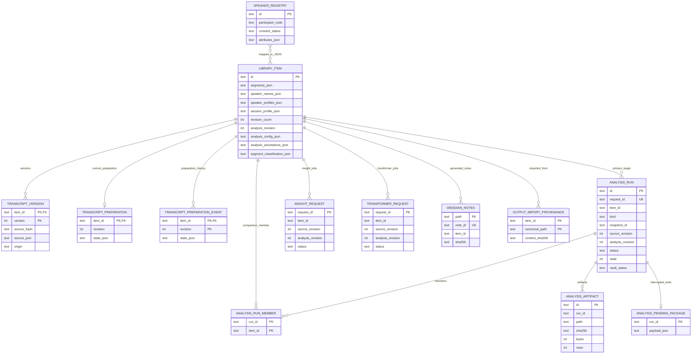

# コア・ハンドラー・ルーティング再編案：現行ER図（SQLite）

親索引・状態・確認版：[[40-Design/10-Analysis/core-handler-routing-reorganization-plan/00-Index]]。必要な本文だけを取得する。

## 現行ER図（SQLite）

`library_items`が会話の最新状態をJSON列でまとめて持ち、固定分析は`analysis_runs`を中心に別管理する。図のうち`transcript_versions`、`transcript_preparations`、`transcript_preparation_events`はSQLite外部キーを宣言している。その他の線は、現行コードがIDで維持する論理関係である。図では`TRANSCRIPT_PREPARATION_EVENT`、`OBSIDIAN_NOTES`がそれぞれ実テーブル`transcript_preparation_events`、`obsidian_notes`に対応する。

次の補助テーブルは図を読みやすくするため省略した。

- `application_metadata`：話者台帳revision、移行済みフラグなどのkey-value
- `training_events`：編集から作った学習イベント。関連IDを独立列ではなくpayloadに持つ
- `output_import_tombstones`：削除済み取り込み元の再取り込み防止
