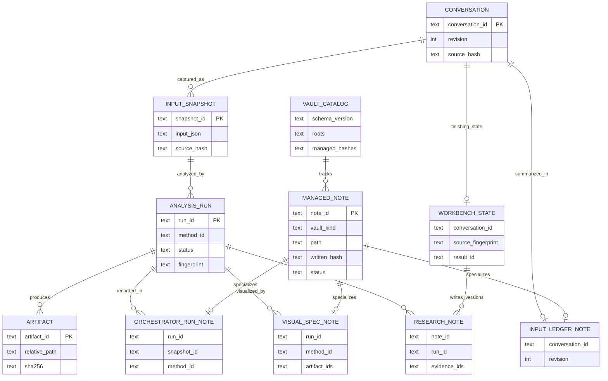

# コア・ハンドラー・ルーティング再編案：現行ER図（成果物・Obsidianを含む概念関係）

親索引・状態・確認版：[[40-Design/10-Analysis/core-handler-routing-reorganization-plan/00-Index]]。必要な本文だけを取得する。

## 現行ER図（成果物・Obsidianを含む概念関係）

重要な境界は次のとおり。

- Vault間の関係はWikilinkではなく`conversation_id`、`snapshot_id`、`run_id`、`artifact_id`、`note_id`で解決する。
- Input／Visualization／Orchestratorの管理ノートは`vaults.json`のhashと`VaultRegistry`の競合処理を通す。
- ResearchVaultは`AnalysisStore`、`ObsidianLayout`、`ObsidianWorkbench`の既存経路を維持する。
- Software VaultはGit管理であり、実行中のアプリは書き込まない。
