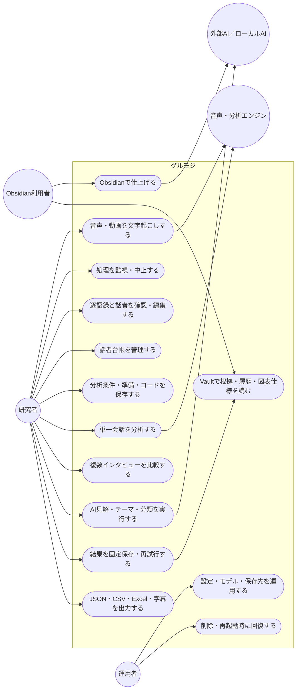
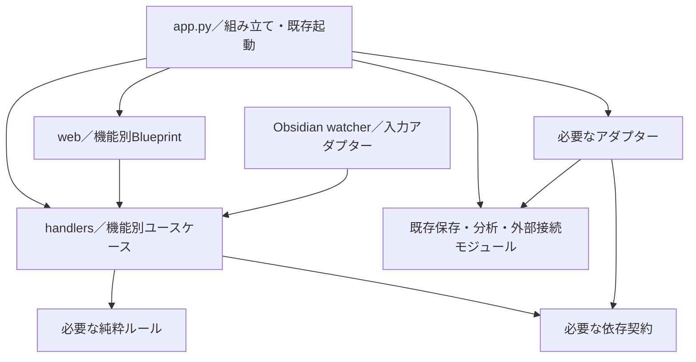

# コア・ハンドラー・ルーティング再編案：現行ユースケース図

親索引・状態・確認版：[[40-Design/10-Analysis/core-handler-routing-reorganization-plan/00-Index]]。必要な本文だけを取得する。

## 現行ユースケース図



## 改訂案の構成と依存方向

2026-09-21の追加要件は [分析マイルストーン・可視化統合設計](../../analysis-milestone-visualization-design/00-Index.md) の第13〜17節にまとめた。分析コアがメインとの応答、実行ハンドラーへの指示、データ不足・エラー対処、結果集約を統括する。コア内部の純粋規則とRuntimeを分離し、既存AnalysisCommands/Queriesは入口として維持する。以下の旧図のCoreは純粋規則を指し、新設計の分析コア全体とは範囲が異なる。役割別オーケストレーターは共通JSON契約で各LLMへ接続し、Obsidianも既存の所有権・保存契約を継承する。これは設計案であり、実装済みを意味しない。

次の図は**移行済みの機能におけるimport依存**を示す。実行時は組み立て側が具象関数をHandlerへ渡す。



- `web`、`handlers`、`core`から`app.py`への逆importを禁止する。新設モジュールは関数内importでも回避しない。
- HTTPはBlueprintで変換し、watcherはHTTPを経由せず対象Handlerを直接呼ぶ。既存watcherの移行は後半まで行わない。
- Coreは具象adapterをimportしない。初期は関数引数や小さな依存オブジェクトで十分であり、Protocolは差し替えや契約の明示に必要な箇所だけ定義する。
- 既存の循環依存の全解消は開始条件にしない。移行を妨げる場合に限り、`safe_path`／`write_atomic`／`markdown`などの同一実装を下位モジュールへ局所抽出する。意味の異なる原子的書き込み関数は名前だけで統合しない。

### 各境界の最小契約

| 境界 | 責務 | 維持する制約 |
| --- | --- | --- |
| Routing | HTTPの構文検証、認証、入力・応答変換、`send_file`などの配信 | 業務処理を持たない。既存status、JSON、header、ダウンロード名を維持 |
| Handler | 1操作の調整、業務条件の検証、依存の呼び出し | Flaskの`request`／`jsonify`を受け取らない。HTTPの構文検証と業務上のrevision照合を分ける |
| Core | 実際に再利用される純粋な判定・変換 | Flask、SQL、ファイル、環境変数、threadを持たない。既存の純粋関数は移動不要ならそのまま利用 |
| 既存保存・分析・外部接続 | SQLite、ファイル、分析実行、Vault公開 | 実装・保存形式・呼び出し回数を維持。Handlerのために全機能を包み直さない |
| Runtime | ジョブ受付、取消、lock、threadの所有 | 同一状態の所有者は1つ。既存のDB／JSON上の回復データをメモリーへ移さない |

Handlerの戻り値はまず必要なdict・既存結果型を使う。単に包み直すCommand／Queryクラス、全機能共通の`OperationResult`、独自のDIコンテナーは作らない。HTTP固有の`local_path_access_allowed()`や`request.url_root`は入口で評価し、必要な値だけを渡す。

### 初回に必要な構成

```text
src/gurumoji/
  app.py                       # 既存起動・設定・依存の組み立て。未移行処理も残る
  web/
    analysis_routes.py         # 移行対象の分析ルートだけ
  handlers/
    analysis_queries.py        # 手法一覧・履歴・成果物取得
  analysis_method_registry.py  # 既存の手法・保存用結果契約
  analysis_store.py            # 既存の保存・再試行・公開実装
```

`__init__.py`等の必要なパッケージファイルを除き、最初に作る機能ファイルはこの2つを基本とする。実際に必要になった段階で保存Handlerや純粋ルールを追加する。`bootstrap.py`、全Entity・Port、`runtime/*`、`analysis/catalog.py`、入出力adapter群の先行作成は行わない。
