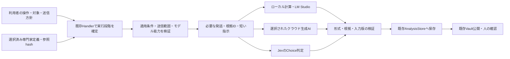

# コア・ハンドラー・ルーティング再編案：5. AI呼び出しの実行境界

親索引・状態・確認版：[[40-Design/10-Analysis/core-handler-routing-reorganization-plan/00-Index]]。必要な本文だけを取得する。

### 5. AI呼び出しの実行境界

図の実行先は全てを毎回呼ぶ意味ではなく、選択された段階だけを実行する。

1. `method_id`、対象ID／revision、利用者が選んだ役割とproviderから段階を決める。手法・前提の解決は既存レジストリと`method_experts`を使う。AIが自由にモデル呼び出しやファイル書き込みを追加する仕組みは作らない。
2. ローカルで入力範囲、除外対象、専門家定義の妥当性・AI補助可否を確認する。ノート内の自由文を実行命令として扱わず、検証済み実行定義の既知の項目だけを利用する。
3. 現行の段階別プロンプト・分割処理を使い、`source_ids`、revision／hash、発話ID、必要な文脈、短い専門家指示を組み立てる。Vault全体・CSV全件・関係のない研究ログを送らない。全文が必要な処理でも、対象操作の許可範囲内で分割し、欠落や切り詰めを記録する。
4. 最初の送信前に対象の版・知識hashを再確認し、AI-2では固定済みcontext packetと照合する。不一致なら送信せず、再確認した別要求へ戻す。以降のバッチ・再試行は同じpacketを使い、現行の定義を読み直して混ぜない。実行中の原文・知識変更は現在版との差として記録し、保存済み入力に対する結果を現行データへ自動適用しない。取消と時間上限は段階・バッチに伝播する。
5. 出力schema、列挙値、確率の範囲・総和、根拠IDを検証する。失敗した応答は成功扱いにせず、必要な部分結果と失敗段階を保持する。
6. 成功した結果を既存runへ保存し、Vaultは保存済みの結果から公開する。同期・索引更新・知識hashの更新を契機にAIを再実行しない。

### 6. 実行要求・設定・来歴の管理

`JobOptions`や既存要求payloadを拡張する際の論理項目を以下に示す。全機能共通DTOや新しい汎用ジョブDBを先に作る要求ではない。

| 項目 | 設計内容 |
| --- | --- |
| 対象と役割 | request／run／step ID、task、method ID、入力snapshot・revision・fingerprint |
| 接続と能力 | provider、要求model、応答が返す実model（取得できる場合）、実行場所、必要能力、資格情報の参照。秘密値は記録しない |
| 入力の由来 | expert ID、definition version、knowledge hash、参照ID、プロンプト・schemaの版、必要な除外／分割条件 |
| 実行条件 | 選択した送信方針、段階別effort、入力・出力上限、時間上限、許可した試行回数、取消情報 |
| 実行結果 | 成功／失敗段階、経過時間、実試行数、providerが報告したusage、検証結果、保存したartifact ID |

- AI-2では、実際に使う短いcontext packetの固定保存を必須にする。packetは選択済みの専門家ID・定義版・knowledge hash、brief、許可した段階と根拠ID、禁止事項、使用prompt／schema版、入力参照・除外／分割条件を持つ。本文は既存snapshotへのID／hash参照を優先し、必要な変換・抜粋だけを固定する。全文の知識ノートや資格情報は含めない。
- 最初の送信前にpacketを既存`analysis_store`管理の版付き入力artifactとして保存し、canonical bytesの`context_packet_hash`を要求・fingerprint・結果から参照する。全prompt・通信ログの別保存庫を作らない。相談・分析の役割ごとに実際のpacketを区別する。
- 同じ要求の分割処理・形式修正・明示再開では固定packetを使う。後から知識が変わってもpacketを上書きしない。新しい知識で分析する場合は再確認した新要求とし、旧結果と知識変更後の表示を分ける。旧runにpacketがなければ「指示本文は未記録」とし、現在の定義から補完しない。
- 新規項目を永続化する段階ではpayloadの版と旧データの読取方法を決める。旧runの不明なprovider・usage・知識版を推測して埋めず、未記録として表示する。既存run・ID・hashは再生成しない。
- `jev-latest`等の可変名だけでは同一モデルを再現したとは言えない。実modelやrevisionが取得できなければ、その再現性の限界を残す。定義変更は新規実行と表示上の再確認へ反映し、過去成果物は固定する。
- usage未報告を「0トークン／無料」と表示しない。初期は回数・時間・取得できたtokensを管理し、金額を出す拡張には別途版付き料金設定と推定表示を用いる。
- 要求の受付重複とprovider側の実行重複を区別する。タイムアウト後の到達状況が不明な要求を無制限に再送しない。形式修正等の既存再試行は挙動維持の抽出後に整理し、総回数・時間の予算を段階全体で管理する。
- ローカルGPUをWhisper・Transformer・LM Studioが共有する点を考慮し、初期は競合する重い段階の逐次実行を基本とする。LM Studio等の外部プロセスのGPU使用はアプリのlockだけで制御できないため、未読込・メモリー不足を明示し、勝手なモデル停止やクラウド切替は行わない。
