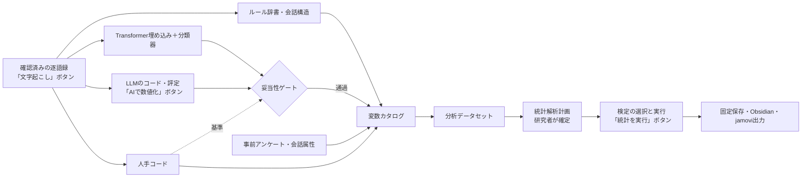

# 発話の数値化とjamovi型統計の自動実行計画：3. 設計原則

親索引・状態・確認版：[[40-Design/10-Analysis/quantification-statistics-plan/00-Index]]。必要な本文だけを取得する。

## 3. 設計原則

1. **判断の分担**
   - 研究者：研究質問、確認的か探索的か、分析単位、変数の定義（コードブック・評定基準）、検証サンプルの判定、解釈。
   - コード：データセットの生成、選択表による検定の決定、前提の確認、効果量、補正、報告文の数値、jamovi出力。
   - AI：発話へのラベルと評定の候補。任意で分析計画の下書き。検定の選択、p値、報告文の数値は作らせない。
2. **測定と推論を分ける。** 変数ごとに出所・版・尺度・妥当性の状態を持つ。`validated`でない変数は確認的な計画に選べず、探索的な分析では状態を表示する。
3. **分析単位を明示する。** 発話／会話内の話者／会話をまたぐ参加者／インタビューのどれで検定したかを、結果の行に残す。
4. **既存の契約に載せる。** fingerprint、`stale`、`not_run`・`empty`・`unavailable`・`fallback`・`partial`、根拠発話ID、固定保存、Vault出力（[[50-Analysis-Methods/00-Orchestrator-Common-Contract]]）。計算できない値を0やp=1で埋めない。
5. **追加より統合（ADR-106）。** 新しいファイルは、既存の重複を置き換える場合に限り、理由をADRに書く。
6. **送る情報を最小にする。** クラウドLLMへの送信は許可するが、判定に必要な本文・話者ID・役割・文脈だけを送り、同意の状態を確認する（ADR-111）。
7. **トークンを使う操作を分ける。** 送信は、利用者が「AIで数値化」を押し、送信先・件数・推定トークンを確認したときだけ行う。
8. **配布条件に合う依存だけを使う。** プロセス内でimportする依存は、12章の方針に合うものに限る（ADR-113）。

## 4. 全体の流れ

