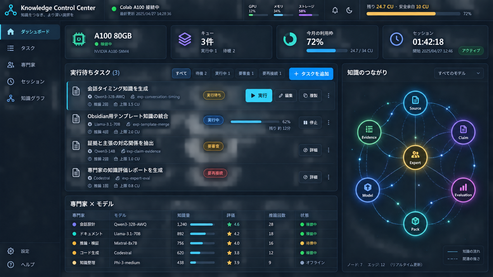
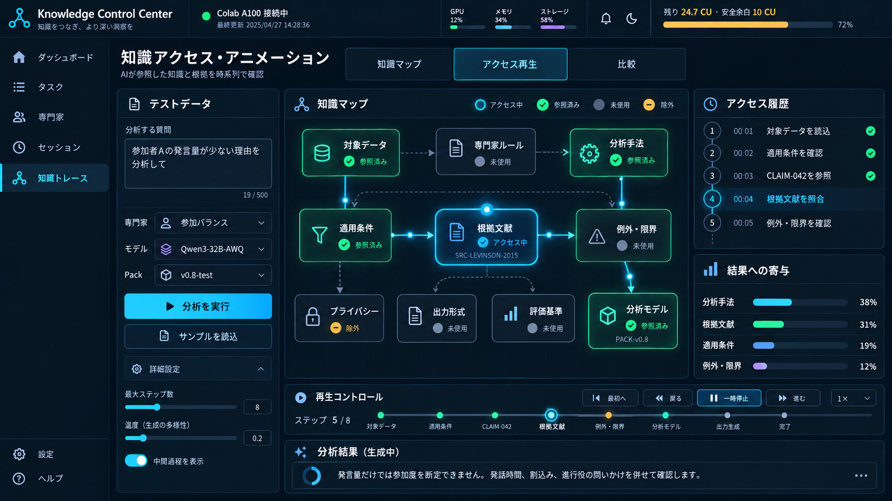

# A100知識推論コントロールプレーン計画：UIイメージ

親索引・状態・確認版：[[40-Design/20-Knowledge/a100-knowledge-control-plane-plan/00-Index]]。必要な本文だけを取得する。

## UIイメージ

### 目標モード（2026-09-30）

専用Web UIの「目標モード」で、目標名・説明、成果物スコア（1〜100点）、目標知識量
（必要な対象ノート1〜500件）、整理率（0〜100%）、必要な深さ（1〜3）、検索到達率
（0〜100%）、タスクごとの最大反復回数（1〜10）、生成タスク上限（1〜5）を保存する。
全ノートを一律に整理するのではなく、利用者が目標に必要な対象を選ぶ。知識量は対象ノート数の
目安であり、意味的な知識量とは区別する。分割・リンク数の増加だけでは品質を加点しない。
旧設定は読み込み時に整理率80%、深さ2、検索到達率80%を補い、既存ノートを書き換えない。
トークン削減率の参考目標（0〜99%）は互換性のため保持するが、目標達成判定には含めない。
式は `(1 - 削減後tokens / 削減前tokens) * 100`。実測は未接続。

整理と深さは利用者の確認記録であり、自動的な正しさの判定ではない。
整理率は「重複・矛盾・出典の3項目を確認済みの対象ノート数 / 対象ノート数」。深さは
0=未整理、1=説明、2=根拠と具体例、3=適用条件と限界。確認した根拠・不足を必須入力とし、
ノートIDと内容hashに結び付ける。画面には確認済み件数・深さの平均を併記する。
未確認の深さは未評価。編集・削除したノートの古い確認記録は加算しない。

検索テストは想定質問、検索語（1〜8個）、到達したい対象ノート（1〜5件）を最大20ケース保存する。
対象のタイトルと本文を大文字小文字を区別しないAND条件で検索し、タイトル一致を優先、同点はID順。
必要なノートがすべて上位5件に入れば成功とする。正解IDを順位計算に使わない。
到達率は成功ケース数 / 全ケース数で、ケース未登録は未測定。Obsidian本体や意味検索の評価ではない。

5つの目標値（知識量、整理率、深さ、検索到達率、成果物スコア）は個別のスライダーで設定する。
「現在のスコアを測定」は保存済みの対象・確認記録・検索ケースを再計測し、未設定の項目は未評価と表示する。
「目標タスクを自動生成・実行」は現在値との差をローカルLLMへ渡し、知識の収集、整理、深化、
インデックス改善、成果物改善の順で不足を優先してタスク化する。生成した今回の目標タスクだけを
A100へ送り、各タスクでは既存の採点・反復処理を目標点または最大回数まで続ける。
整理、深さ、検索条件はモデルの自己申告で達成扱いにせず、利用者が結果を確認して再計測する。

目標ごとに `<KNOWLEDGE_CONSOLE_DATA_DIR>/goal_workspaces/<goal_id>/Vault` を作り、
Obsidianで開く。既存の4+1 Vaultとは独立した開発用作業領域で、自動削除・既存Vaultからの
自動コピー・既存ノートの上書きは行わない。画面からのノート追加は新しいstable IDのファイルを
作り、`vault_note_policy.write_generated_note` で初版履歴を保持する。
利用者は `10-Knowledge/*.md` を直接編集・追加できる。サブフォルダーと履歴はAI検索対象外。

設定とgoal/task/planの関連は既存 `knowledge_builder/state.sqlite3` 内の
`knowledge_console_goals`、`knowledge_console_goal_plans`、`knowledge_console_goal_tasks` が正本。
確認記録は `knowledge_console_goal_assessments`、追記型の計測・成果物評価履歴は
`knowledge_console_goal_measurements` に保存する。これらも同じSQLite内に置き、Vault本文を変更しない。
スキーマは既存テーブルへの破壊的変更を伴わない追加。設定はrevisionで競合検出する。
計画の入力スナップショットはVault外の `goal_workspaces/<goal_id>/plans/<plan_id>.json` に保存する。
以前のアプリに戻しても既存タスクは読めるが、目標タスクの実行にはこの版が必要。
ロールバック時は目標由来のタスクを旧版で実行せず、作業Vaultと追加テーブルを保持する。

「LLMでタスクを生成」は明示的に選んだ1〜3ノート（合計最大6000文字の抜粋）、目標値、
現在の計測値、選んだノートの確認記録、最新の有効な成果物評価の改善点を
ローカルLLMに渡す。frontmatter、リンク先、資格情報らしい文字列は入力から除外し、
ノートID・内容hash・省略の有無を記録する。未知の専門家・参照ID・改善対象、過剰件数、
重複タスクを拒否し、全案を検証してから既存タスク台帳へまとめて下書き登録する。
同じ設定・参照ノートからの重複登録は行わない。LLM未接続時は理由を表示し、架空の案へ代替しない。
評価結果・確認記録の変更も入力の変更として扱う。改善対象は `score/knowledge/organization/depth/index`。
必要な知識の不足を優先し、focusに改善前の不足・作業内容・改善を確認する方法を含める。
旧 `compression` タスクは履歴に残し、新規提案には採用しない。

生成されたタスクは「A100タスクで実行」から既存の個別／一括実行へ進む。目標とノートの変更を
実行前に確認し、変更されていれば再生成を要求する。Workerには署名済み要求の既存
`analysis_focus` に目標・作業方針・参照抜粋を渡すため、ノート内容を知らずに実行することはない。
タスクごとの採点・反復は既存処理を使う。成果物の総合評価は、利用者が実際に使ったプロンプト
（6000文字以内）・実際の成果物（12000文字以内）・対象内の根拠ノート1〜3件を指定して実行する。
ローカルLLMは `goal-artifact-v1` の固定基準（目標の充足・根拠・一貫性・再利用性、各25点）で採点。
架空の結果への代替や、タスク得点の平均による総合点の算出はしない。評価入力は既存の抜粋・秘匿処理を
通し、SQLite履歴に実際の評価入力、hash、参照ID、評価モデル、評価理由を保存する。
目標・対象ノート・確認記録が評価中に変わった場合は保存せず、保存後の変更は再評価が必要と表示する。

実行時の根拠検査（2026-09-30）: 新規の実モデル実行には目標モードから生成した根拠ノート付き
タスクが必要。メタデータだけの旧タスクは実行APIが400で止め、資料を加えた再生成を案内する。
Workerへの指示は `evidence-v1` のJSON（`status`, `findings`, `citations`, `missing_inputs`）を要求する。
`needs_input`、不足入力あり、形式不正、参照ID不明、提供抜粋に存在しない引用の場合は、応答を保持して
タスクをfailedにし、採点・自動反復を停止する。正常時も引用の照合を確認できた段階であり、意味の正しさの
保証や人による承認ではない。既存の`succeeded`は書き換えず「応答受信・未評価」として表示する。
新規応答の照合状態と参照hashは結果の`quality`に保存し、成果物の採点・整理・深さの確認とは分ける。

保存と反復停止（2026-09-30）: タスク結果の保存上限は2MiB。最大512KiBのWorker応答を受け取る
搬送上限に対し、停止時の応答・最良成果物・引用照合結果・反復履歴を全文保持できる容量とする。
旧32KiB上限での例外や空オブジェクトへの置換は行わない。上限外のデータは保存前に明示的に拒否し、
既存の保存結果は保持する。DB形式・保存先は変えず、過去の結果の移行も不要。
反復途中の入力不足・形式不正・採点失敗・通信失敗では、`best_attempt`に最良の採点済み成果物を残し、
直近応答と区別する。`interrupted`と`stopped_iteration`を記録し、画面に最良成果物の本文を表示する。
停止した試行には以前の点数を付けず、以前の採点履歴は保持する。
`needs_input`で失敗したタスクは一括計画で保留し、ローカルLLMへの実行判断依頼からも除外する。
不足資料を追加した後は目標モードでタスクを再生成する。個別の明示的な再実行操作は残す。

エラー履歴: 既存の`knowledge_console_events`を追記専用の履歴として使い、自動削除しない。
タスク失敗は受信したエラー本文（資格情報は除外）、日時、実行回、反復回、発生時フェーズ、品質状態を保存する。
現在の`error_message`表示は500文字の要約で、再実行・成功でクリアしても履歴は残る。
接続エラーは状態・メッセージが変わったときに記録し、同一状態のポーリングを重複保存しない。
復旧してから同じエラーが再発した場合は別の発生として記録する。APIの400以上の応答も記録する。
`GET /events?errors_only=1&limit=50&before=<sequence>`で古い履歴まで取得でき、応答の`next_before`で
次のページへ進める。A100画面の「保存されたエラー履歴」から本文を開き、以前の記録を追加表示する。
元から残っている失敗イベントも表示する。過去に短縮済みの本文やPCが受信していないColab内部ログを
復元する機能ではない。新たな保存先・削除操作は追加しない。

量と整理済み量、深さ、検索到達率、成果物スコアを別グラフと履歴表で表示する（最新200記録）。
進捗は設定フォームより上に置き、5条件の達成状況、現在値・目標マーカー・残り、次の確認欄への
導線を表示する。深さの達成カードとグラフは「必要な深さに到達した対象ノート数／全対象」で示し、
平均値は履歴表に残す。未評価と再確認を区別し、内容変更前の記録は現在値として表示しない。
グラフは直近12記録／取得済み最大200記録を切り替え、日時・目標線の値・表示範囲の初回比を表示する。
点の選択はポインター・タッチ・キーボードで行え、記録時点の数値を確認できる。
目標revision・対象ID・検索ケース・評価基準が異なる履歴は比較から除外する。成果物は評価モデルと
根拠ノートIDの組み合わせも揃える。スコア到達予想は同条件の異なるプロンプト／成果物の直近3評価が
連続して改善した場合だけ、平均改善量から残り評価回数を線形推定する。保証ではなく、他はデータ不足と表示。
目標達成は、必要件数・整理率・全対象の必要な深さ・検索到達率・有効な成果物スコアがすべて目標を
満たしたときだけ表示する。生成物の知識ノートへの自動採用、最終成果物の自動生成・自動再評価は行わない。
自動モードはタスクの生成・投入・タスク内の採点反復を自動化するが、生成結果を確認済み知識として扱わない。

API: `GET/POST /api/knowledge-console/goals`、`GET/PATCH /goals/<goal_id>`、
`POST /goals/<goal_id>/notes`、`POST /goals/<goal_id>/generate`、
`POST /goals/<goal_id>/assessment`（対象と確認記録の保存）、`POST /goals/<goal_id>/measure`（再計測）、
`POST /goals/<goal_id>/evaluate`（成果物評価）。すべて同じAPI接頭辞。
後3つは `goal_revision` と確認記録の `revision` によって競合検出する。
リクエストは原則64KB、最大500ノートの確認記録を扱うassessmentだけ2MBまで。
書き込みは既存のlocalhost/Origin/専用ヘッダー制約を継承する。

この画像は画面構成の方向性を確認するためのモックアップであり、表示値は例示である。実装時は本計画の状態名、予算判定、アクセシビリティ要件を正本とする。

### 知識トレース専用タブ

ダッシュボードの小さい関係図とは分離し、テストデータを入力して知識アクセスを確認する操作は専用の「知識トレース」タブで行う。
