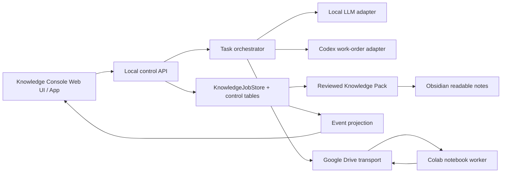

# A100知識推論コントロールプレーン計画：3. 実装境界

親索引・状態・確認版：[[40-Design/20-Knowledge/a100-knowledge-control-plane-plan/00-Index]]。必要な本文だけを取得する。

## 3. 実装境界

### ローカル側

- `KnowledgeJobStore`をジョブ、generation、Commit、Packの正本として継続利用する。
- 新しい管理用テーブルは同じSQLite内へversion付きmigrationで追加する。
- 管理APIは `127.0.0.1` のみにbindし、既存のcross-site/CSRF防御を再利用する。
- UIは正本を直接編集せず、API経由で状態遷移と監査イベントを残す。
- 推論結果はcandidateのまま受け取り、独立した審査を通るまでapprovedにしない。

### Colab側

- Colabは要求ZIPをpullし、固定されたworker/model/promptで1件ずつ処理し、結果ZIP、checkpoint、heartbeatをDriveへpushする。
- Drive上のSQLiteを直接共有しない。
- Colab workerにはSourceの採用権限、Claimの承認権限、Pack公開権限を与えない。
- 同じjob/generation/attemptの完全一致結果だけを冪等に取り込む。
- キューが空ならGPU health probeを続けず、worker loopを終了する。A100を待機のためだけに保持しない。

### Obsidian側

- 人が読む専門家定義と説明はSoftware Vaultを正本とする。
- アプリはSoftware Vaultへ書かない。専門家定義の変更は人がレビューしたGit変更だけで行う。
- 大きなSource、実行状態、評価明細、関係グラフはSQLite/JSON/JSONLを正本とする。
- OrchestratorVaultへは、採用済みの知識概要、評価結果、provenance、Pack版だけを生成ノートとして公開する。
- stable IDで関連付け、VaultをまたぐWikilinkや表示名一致に依存しない。
- 同期はA100再実行や重い再評価を暗黙に起動しない。入力変更時は派生物をstaleにする。
