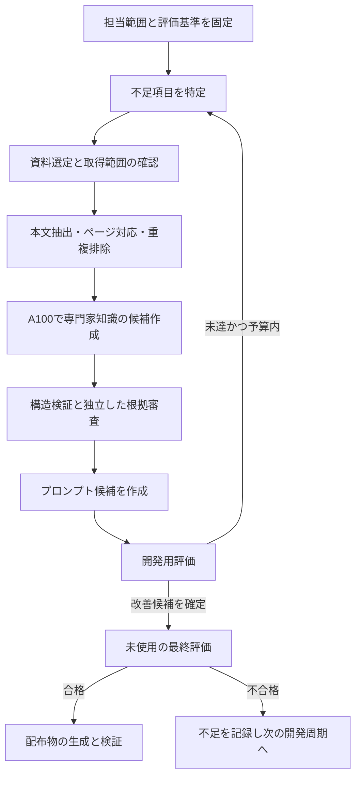

# 配布用専門家の知識・プロンプト制作計画：4. 制作の流れ

親索引・状態・確認版：[[40-Design/20-Knowledge/expert-knowledge-production-plan/00-Index]]。必要な本文だけを取得する。

## 4. 制作の流れ

1. 各専門家の担当範囲を項目表にする。理論、用語、前提、手順、適用不可、反例、出力、限界を分け、必須項目を先に固定する。
2. 資料は原典論文・書籍・公式資料を優先し、解説記事は補助として扱う。書誌のみ、要旨、本文の区別と読めたページを残す。
3. ローカルで取得・抽出・重複判定を行う。A100への送信は送信可能と確認した資料のみとする。ローカル限定資料は端末内で処理する。
4. 専門家役は与えられた資料から候補を作る。モデルの記憶だけの主張は確認候補に置き、出典を補ってから採用する。
5. 審査は原文の該当箇所まで戻る。要約を別モデルが再要約しただけで二重確認済みにしない。
6. 失敗を「資料不足／抽出不良／検索不良／指示不良／モデル能力／評価の不備」に分類する。すべてを資料追加で解決しようとしない。
7. 合格した候補はまず内部候補Packとして固定する。P7で全評価・P4復旧gateを確認した不変の`ReleaseApproval`をPack rootへ紐付けるまで、配布用承認領域・ZIP・runtime readerで利用可能にしない。

資料候補の入口は、既存文献ID、利用者が指定したURL/DOI、ローカルの資料台帳とする。追加検索は設定された検索API・学術メタデータ取得器を通常のコードで呼び、LLMは検索語と採否を判断する。検索手段が未設定なら候補受付までで動作し、LLM単体がインターネットを検索したとは扱わない。

資料1件ごとに最低限、`source_id`、既存`LIT/RES` IDとの対応、DOIまたはURL、確認日、確認範囲、抽出方式、原本hash、配布可否、送信可能先を記録する。PDFは物理ページ番号と印刷ページ番号を区別し、Webは節・段落・取得版を記録する。

スキャンPDFはOCRの結果と原画像を照合できるようにし、欠落・図表・数式の抽出失敗を記録する。読めなかった箇所を本文確認済みにしない。訂正・撤回・後続の反証は既存の訂正状態と関連レコードで残す。
