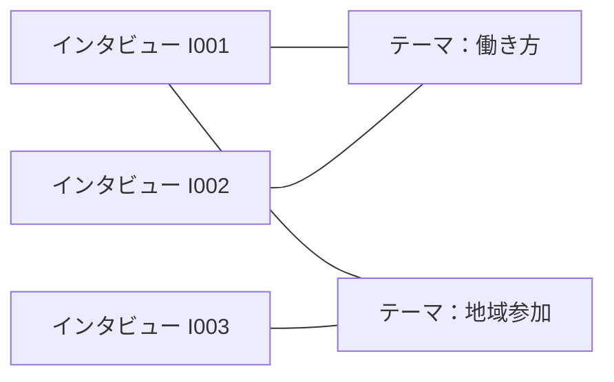

# Obsidianの全体・インタビュー別表示の再設計：2. 保存階層をインタビュー中心にする

親索引・状態・確認版：[[40-Design/40-Storage/obsidian-graph-plan/00-Index]]。必要な本文だけを取得する。

## 2. 保存階層をインタビュー中心にする

```text
ResearchVault/
  00-ホーム.md
  10-インタビュー/
    I001-働き方の聞き取り/
      I001-概要.md
      I001-全文.md
      I001-アウトライン.md
      I001-分析まとめ.md
      I001-研究メモ.md
      I001-操作.md
      I001-状態.md
      I001-保存原文.md
      履歴/                     過去の仕上げ版・分析実行結果
    I002-地域活動の聞き取り/
      ...
  20-テーマ/                    インタビューを横断する概念・コード
  30-人物/                      確認済みの話者プロフィール
  40-研究/                      研究目的・横断比較・研究メモ
  80-添付/
  90-運用/                      手法説明・テンプレート・保存ガイド
```

上記は表示例。`I001` は読みやすい表示用IDとし、既存の会話ID・note_id・発話IDは変更しない。グラフ上でも識別できるよう、ファイル名にインタビューIDと用途を入れる。同名の「会話」「状態」や長い実行IDだけが並ぶ状態を避ける。

本文は録音1件の全文を1ノートに保存する。各発話はブロックIDで参照し、発話ごとのノートは作らない。全文・アウトラインなど現在読むノートは浅い位置に置き、履歴の深い階層は普段閉じて使う。

概要ノートには「全文」「アウトライン」「分析まとめ」「研究メモ」「仕上げ操作」へのリンクと関連テーマを置く。原文・状態・過去版も概要から開けるが、通常のグラフでは補助資料として除外する。

「全文」の手動編集を保護し、AIの生成結果は別の候補版として保存する。候補の確認とアプリへの反映後に、最新版への参照と履歴の表示区分を更新する。過去の本文・根拠を最新版で置き換えない。

## 3. グラフ用の分類とリンクをそろえる

既存の `note_id`、`note_type`、`conversation_id` を保持し、表示用の情報を追加する。

| 情報 | 例 | 役割 |
| --- | --- | --- |
| tags | `graph/overview` | 全体グラフに出す概要・テーマ・研究 |
| tags | `graph/detail` | インタビュー別に出す全文・アウトライン・分析・メモ |
| tags | `graph/support` | 操作・状態・保存原文・運用資料 |
| tags | `graph/history` | 過去版 |
| tags | `interview/i001` | 当該インタビューと関連するノート |
| graph_kind | `interview` / `theme` / `analysis` / `memo` など | 種類別の色分け |

`interview/i001` はその会話のノートに付け、関連する共通テーマにも付ける。複数インタビューに関係するテーマには複数の所属タグを持たせる。タグの所属は、確定したリンクに基づいて更新し、ユーザー独自のタグを保持する。

グラフ用のタグはノートの分類に使い、グラフ内でタグ自体を点として表示する設定は通常オフにする。テーマは独立したノートとして表現する。

全体表示の検索条件案：

```text
tag:#graph/overview -tag:#graph/history -tag:#graph/support
```

インタビューI001限定の検索条件案：

```text
tag:#interview/i001 (tag:#graph/overview OR tag:#graph/detail) -tag:#graph/history -tag:#graph/support
```

検索式の基本仕様は公式のタグ検索・AND/OR条件に基づく。実装時にはObsidianで検索結果とグラフ表示を照合して確定する。[公式：Search](https://help.obsidian.md/plugins/search)

表示設定は、添付ファイルと未作成ノートを非表示、孤立ノートは表示を初期案とする。未整理のインタビューも一覧から消えないようにする。概要を青、テーマを緑、分析を橙、メモを紫、本文を灰色にする。全体グラフでは特に操作ノート・履歴・手法定義を除外し、ホームへの案内リンクが全ノートをつなぐ巨大な中心点にならないようにする。

関係の例：



線は参照・関連を意味し、意見の一致や因果関係を意味しない。テーマノートには、関連する概要へのリンクと、根拠となる全文の発話ブロックへのリンクを残す。意味の同一性を確認したテーマのみを共通化する。頻出語すべてを自動でテーマノートにしない。

グラフに必要な関係はMarkdown本文またはプロパティの実際の内部リンクとして保存する。画面上だけの検索結果やDataview一覧に、グラフの線の生成を依存させない。本文中の発言を書き換えてリンクを埋め込まず、概要・テーマ・根拠欄にリンクを置く。

標準グラフはノート単位であり、全文内の発話やアウトラインの見出しをそれぞれ独立した点にはしない。議題を点にしたい場合は、研究対象として選んだテーマだけを独立ノートにする。
